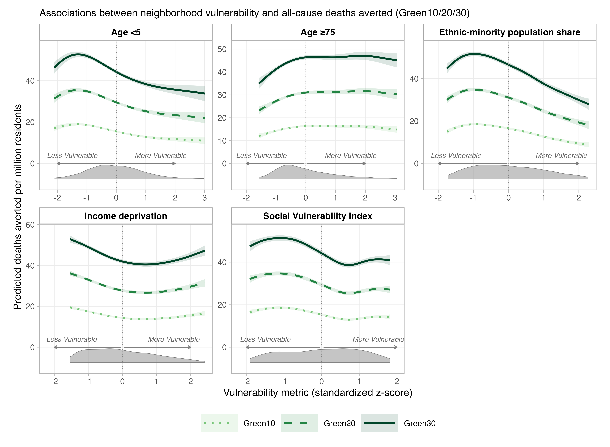
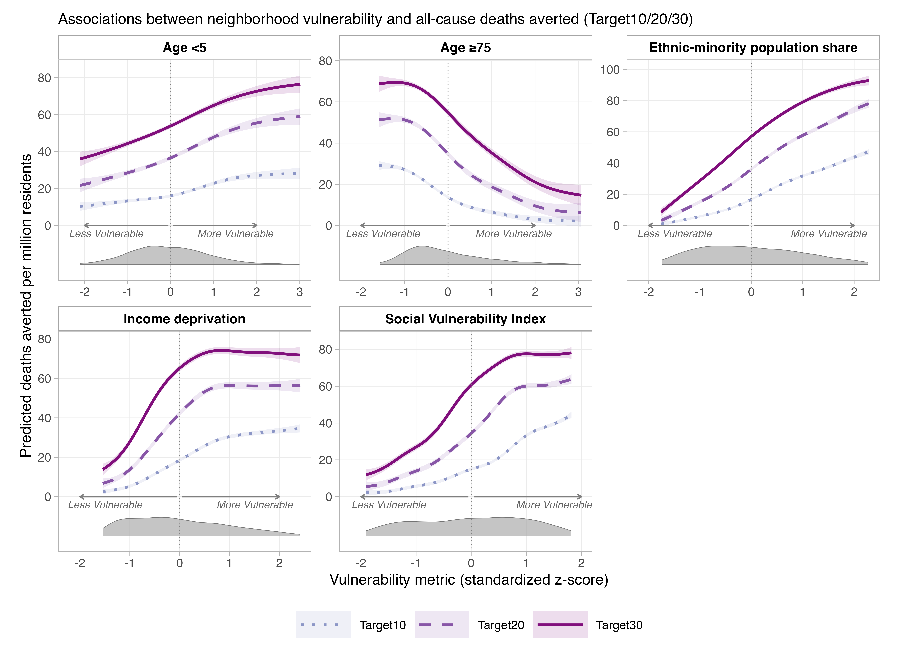

# Figure 6 candidates and manuscript text

Prepared 5 November 2026. Drafts for author review; the Word manuscript has not
been edited. The original allocation candidates use the same revised Green30 cooling inputs,
four-dimension SVI, fixed 2021 population, all 4,835 valid LSOAs, rates per
million and full GAM predictions including the intercept. Allocation remains
an author choice; population allocation is recommended for the main analysis.
For decision rationale and controlled comparisons, use the
[V0–V1 record](V0_V1_HEALTH_AND_FIGURE6_CHANGES.md), not a second methods inventory.

The rendered candidate and comparison figures accompany this non-commercial
research report under the existing [figure release review](../../DATA_LICENCE_AND_REDISTRIBUTION.md#rendered-report-figures-review-4-november-2026).
The [source attribution and reuse notice](SVI_SPATIAL_RESULTS.md#figure-attribution-and-reuse)
applies to these figures too; the code licence does not override input-data rights.
Numerical exports, raw inputs and historical image archives remain local unless
separately released. Links to those local outputs are reproduction references,
not promises that those files are available on GitHub.

## Proposed main-text comparison: Green30 and Target30

[Open the separate 600-dpi PNG](../../figures/figure6/manuscript/equity_health_All_cause_gam_Green30_Target30_per_million_population_full_prediction.png).
This population-allocation candidate adds a direct strategy comparison without
replacing either original Green30 allocation candidate. Supplementary S1 and S2
below retain the three intensities within each family. Figure 7's current
redistribution results are in the [Figure 7 review](FIGURE7_REVIEW.md#proposed-results-paragraph).

### Proposed legend for the comparison candidate

**Fig. 6 | Contrasting neighborhood distributions of modelled health benefits
under general and targeted greening.** Green solid and purple dashed curves
compare Green30 and Target30, respectively. Panels show the proportions aged
<5 and ≥75 and ethnic-minority population share (top row), and income
deprivation and the four-dimension Social Vulnerability Index (SVI; bottom row).
Curves are full fitted predictions, including the intercept, from separate
univariable robust scaled-t generalized additive models fitted by restricted
maximum likelihood across 4,835 London LSOAs. All-cause heat-related deaths
averted per million residents are estimated relative to baseline land use under
identical mid-century climate conditions, with 2021 population and registered
mortality fixed and borough deaths allocated in proportion to population.
Predictors are standardized z-scores; vertical dotted lines mark citywide means.
Shaded bands show pointwise 95% model-conditional confidence intervals. Grey
densities below zero show observed predictor distributions, rescaled independently
of mortality units; arrows indicate lower to higher vulnerability. All valid
LSOAs enter the fits; curves display P1–P99. Y-axis ranges differ between
indicators but are shared by both scenarios within each panel. Associations
are unadjusted for location; intervals exclude spatial dependence and upstream
input uncertainty and are not tests of between-scenario differences.

Reproduce only this candidate:
`Rscript code/compare_figure6_scenarios.R --main-overlay-only`.
Keep the Green Results below and the linked Target Results in separate sections,
even if the combined Figure 6 candidate is selected. In that case, cite Figure 6
alongside Supplementary Figure S2 in the Target section. No new fitting or
numerical results are involved.

## Candidate A population allocation (original Green30 version retained)

[Open the 600-dpi PNG](../../figures/figure6/manuscript/equity_health_All_cause_gam_Green30_20261105_10_per_million_population_full_prediction.png).

### Proposed legend

**Fig. 6 | Neighborhood vulnerability and modelled health benefits under Green30.**
Green30 represents a 30% relative increase in tree-canopy cover and is shown as
an illustrative general-greening scenario; Green10/20/30 and Target10/20/30
comparisons are provided in Supplementary Figs. S1 and S2, respectively. Curves show
separate univariable generalized additive model (GAM) predictions of all-cause
heat-related deaths averted per million residents across 4,835 London Lower
Layer Super Output Areas (LSOAs). Benefits are estimated relative to baseline
land use under identical mid-century climate conditions, holding 2021 population
and registered mortality fixed. Borough mortality is allocated to pixels in
proportion to population. Vulnerability metrics, including the four-dimension
Social Vulnerability Index (SVI; Methods), are standardized z-scores; vertical
dotted lines mark the citywide mean. Blue lines show full predictions, including
the intercept, from robust scaled-t GAMs fitted by restricted maximum likelihood.
Shaded bands indicate pointwise 95% model-conditional confidence intervals.
Grey densities show predictor distributions, rescaled independently of mortality
units; arrows indicate lower to higher vulnerability. All valid LSOAs enter the
models; curves display each predictor’s 1st–99th percentiles. These are
unadjusted citywide associations, and intervals exclude spatial dependence and
uncertainty in upstream model inputs.

### Proposed Results

#### General greening yields uneven neighbourhood health benefits

Generalized additive models (GAMs) showed similar, non-linear patterns of
modelled health benefits across Green10, Green20 and Green30, with Green30
shown as an illustrative scenario (Fig. 6; Supplementary Fig. S1). Benefits
were lower at high than at low income deprivation and ethnic-minority
population share. Under Green30, predicted deaths averted per million residents
were respectively 8.8 and 16.5 lower at the 90th than the 10th percentile.
Income-deprivation curves declined before partially recovering, whereas
ethnic-minority-share curves peaked below the citywide mean and then declined.
Higher overall SVI and under-five population share also corresponded to lower
benefits in all three Green scenarios.

By contrast, neighborhoods with higher proportions of residents aged ≥75
received greater modelled per-resident benefits under the Green scenarios.
Curves generally rose before levelling off or declining modestly; under
Green30, the 90th–10th percentile difference was +5.7 deaths averted per million.
These citywide associations describe neighbourhood-level benefit distributions,
not spatially adjusted or causal effects of vulnerability.

*Continue with [Targeting redistributes benefits across vulnerability dimensions](FIGURE7_REVIEW.md#proposed-results-paragraph).
The Target scenario comparisons and Figure 7 redistribution findings are kept
there rather than repeated in this Green section.*

Population-allocation spatial sensitivity is documented separately in the
[spatial report](SVI_SPATIAL_RESULTS.md); its results do not apply to area allocation.
The age variables describe neighbourhood composition, not age-specific deaths.

## Six-scenario comparison and supplementary figures

**Verified 5 November 2026:** 30 converged GAMs (six scenarios × five metrics),
each using the same 4,835 LSOAs. All five contrast directions agree within
Green10/20/30; all five reverse under each Target scenario. Green30 is therefore
illustrative of the **Green family**, not all greening strategies.

P90 minus P10, in deaths averted per million residents (negative = lower fitted
benefit at higher vulnerability; not negative total benefit):

| Metric | Green10 | Green20 | Green30 | Target10 | Target20 | Target30 |
|---|---:|---:|---:|---:|---:|---:|
| Income deprivation | −4.0 | −6.7 | −8.8 | +28.6 | +47.0 | +54.0 |
| Age <5 share | −6.3 | −10.6 | −14.9 | +11.2 | +22.2 | +23.8 |
| Age ≥75 share | +2.1 | +4.3 | +5.7 | −22.4 | −36.1 | −39.5 |
| Ethnic-minority share | −6.8 | −11.9 | −16.5 | +32.3 | +53.2 | +63.1 |
| Overall SVI | −4.2 | −7.3 | −9.8 | +34.0 | +51.2 | +58.0 |

**Curve shapes:** Green curves are similar, but not identical. Correlations of
the 200 fitted values over each metric's common P1–P99 grid with Green30 are
0.955–1.000 for Green10/20; these are descriptive shape checks, not equivalence
tests. Green10's older-age curve peaks earlier and declines slightly at high
values. Target curves differ from Green curves: deprivation generally rises
but develops an upper-range downturn under Target20/30, while the age-75+
curve broadly declines. Matching contrast signs alone should not be described
as identical or uniformly monotonic curves.

### Supplementary Fig. S1 proposed legend

**Supplementary Fig. S1 | Neighborhood vulnerability and modelled health
benefits across general-greening scenarios.** Panels show, from left to right,
the proportions aged <5 and ≥75 and ethnic-minority population share (top row),
and income deprivation and the four-dimension Social Vulnerability Index
(SVI; bottom row). Light-to-dark green dotted, dashed and solid lines represent
Green10, Green20 and Green30, respectively. Curves are full fitted predictions,
including the intercept, of all-cause heat-related deaths averted per million residents
from separate univariable robust scaled-t GAMs fitted by REML to the same
4,835 London LSOAs. Each scenario is compared with baseline land use under
identical mid-century climate conditions, with 2021 population and registered
mortality fixed and borough deaths allocated in proportion to population.
Predictors are standardized z-scores; vertical dotted lines mark their
citywide means and arrows indicate lower to higher vulnerability. Shaded
bands are pointwise 95% model-conditional confidence intervals. All valid LSOAs
enter the fits; displayed curves span P1–P99. Y-axis limits differ between
vulnerability indicators; the three scenarios share an axis within each panel.
Grey densities below zero show observed predictor distributions, rescaled
independently of mortality units. Associations are unadjusted for location;
intervals exclude spatial dependence and upstream input uncertainty.

Regenerate only this figure, preserving other figures:
`Rscript code/compare_figure6_scenarios.R --overlay-only`.

### Supplementary Fig. S2 proposed legend

**Supplementary Fig. S2 | Neighborhood vulnerability and modelled health
benefits across targeted-greening scenarios.** Panels show, from left to right,
the proportions aged <5 and ≥75 and ethnic-minority population share (top row),
and income deprivation and the four-dimension Social Vulnerability Index
(SVI; bottom row). Light-to-dark purple dotted, dashed and solid lines represent
Target10, Target20 and Target30, respectively. Curves show full fitted predictions,
including the intercept, of all-cause heat-related deaths averted per million residents
from separate univariable robust scaled-t GAMs fitted by REML to the same
4,835 London LSOAs. Population allocation, 2021 population and mortality,
climate conditions and model settings match Supplementary Fig. S1. Each
scenario is compared with baseline land use. Predictors are standardized
z-scores; vertical dotted lines mark citywide means and arrows indicate lower
to higher vulnerability. Shaded bands are pointwise 95% model-conditional
confidence intervals. All valid LSOAs enter the fits; curves display P1–P99.
Y-axis limits differ between vulnerability indicators; the three scenarios share
an axis within each panel. Grey densities below zero show observed predictor
distributions, rescaled independently of mortality units. Associations are unadjusted
for location; intervals exclude spatial dependence and upstream input uncertainty.

Regenerate only this version, preserving Green and main figures:
`Rscript code/compare_figure6_scenarios.R --target-overlay-only`.

S1/S2 are provisional manuscript numbers and now refer to the overlays above.
The earlier 15-panel grids remain available for inspection, but are not the
proposed supplementary versions. No figure files were changed by this text
revision. Compare absolute values using axis labels rather than visual heights
between panels or figures. The existing figure attribution above applies.

**Reproduction:** `Rscript code/compare_figure6_scenarios.R` writes only to
`figures/figure6/scenario_comparison/` and refuses to overwrite completed outputs.
`--redraw` reuses saved results and replaces the two grid and two overlay PNGs.
Fits use all-cause
health outputs at `temperature_setting_c = 25`, the canonical four-dimension SVI,
population allocation, fixed 2021 denominators, `scat()`, REML, `select = TRUE`
and `s(x, k = 10, bs = "ts")`, matching main Figure 6. Predictions include the
intercept; fitting is per 100,000, exported units per million. Source checksums
and session information accompany [contrasts](../../figures/figure6/scenario_comparison/contrasts.csv),
[curve data](../../figures/figure6/scenario_comparison/curves.csv) and
[shape checks](../../figures/figure6/scenario_comparison/shape_checks.csv).
Green30 health-input parity and all five main-figure contrasts passed; hashes
confirmed that existing figures and numerical outputs were unchanged.
No new spatially adjusted models were fitted. These are descriptive comparisons,
not spatially corrected tests or paired tests of differences between scenarios.

## Candidate B uniform area allocation

[Open the 600-dpi PNG](../../figures/figure6/manuscript/equity_health_All_cause_gam_Green30_20261105_10_per_million_area_full_prediction.png).

This is a controlled V0-style reconstruction on the revised grid, not the
historical V0 result. It can serve as a Supplementary figure; a final number
should be assigned only after the main/SM choice.

### Proposed legend

**Fig. Sx | Sensitivity of neighbourhood health-benefit patterns to uniform-area
mortality allocation.** Curves show separate univariable GAM predictions of
all-cause heat-related deaths averted per million residents under Green30 across
4,835 London LSOAs. Borough 2021 registered deaths are distributed uniformly
across equal-area pixels, preserving borough totals. Revised cooling fields,
exposure–response parameters, population denominators and neighbourhood data
are otherwise unchanged from the population-allocation analysis. This is a
controlled reconstruction of the earlier allocation assumption, not a rerun
of the complete historical pipeline. Vulnerability metrics are standardized
z-scores; the vertical dotted line marks the citywide mean. Arrows indicate
less to more vulnerability. Blue lines are
full predictions, including the intercept, from robust scaled-t GAMs fitted
by REML; bands are pointwise 95% conditional confidence intervals.
Grey densities indicate predictor distributions
and are rescaled independently of mortality units. All LSOAs are fitted, with
P1–P99 displayed. Associations are not spatially adjusted, and intervals omit
spatial dependence and upstream input uncertainty.

### Proposed Results

Under uniform-area mortality allocation, the fitted P90–P10 contrasts retained
the same directions as the population-allocation analysis: −13.2 deaths per
million for income deprivation, −20.1 for the proportion aged <5, −15.6 for
ethnic-minority population share, −12.8 for SVI and +9.9 for the proportion
aged ≥75. The older-age curve increased more consistently, while deprivation
and SVI contrasts were more negative. Thus, broad directions persisted, but
their magnitudes and nonlinear shapes depended on the mortality-allocation
assumption. Residual spatial autocorrelation remained substantial; these
unadjusted associations are descriptive, not independent effects of vulnerability.

Spatially adjusted area-allocation models are **on hold**; see the
[Figure 6 TODO](../../TODO.md). Focus review on the main citywide patterns.
Candidate A's spatially adjusted conclusions do not apply to B.

## Suggested supplementary selection

1. Retain the population-allocation spatial sensitivity (k = 50, 100 and 200),
   with its residual-dependence caveat. The curves there remain centered
   vulnerability contributions; they are not the full predictions above.
2. Use Candidate B or the allocation overlay as one allocation-sensitivity
   figure. Avoid including both if they duplicate the same message.
3. Keep the side-by-side normalization comparison in the local decision record;
   add it to the Supplement only if needed to explain the estimand choice.

## Figure 7 consistency review

The read-only [consistency test](../../code/tests/test_figure7_reporting_consistency.R)
passed on 5 November 2026: 4,835 paired LSOAs, the stored four-dimension SVI,
the same revised population-allocated health input and 2021 population lookup,
and all saved high-vulnerability/low-benefit counts reproduced.

- Benefit classes use **rates per resident**, not raw LSOA death totals.
  Green30's tertile thresholds are reused for Target30. Figures 6 and 7 use
  different summaries of vulnerability (continuous GAM versus tertile groups),
  not different SVI constructions.
- Figure 7's per-million conversion is complete. The consistency test confirms
  unchanged classifications and counts; see the [current Figure 7 legend](FIGURE7_REVIEW.md#proposed-revised-legend)
  for thresholds and the preferred display. No further unit conversion is needed.
- Retain the age-75+ trade-off: the high-age-75, low-benefit share rises from
  28.7% to 59.0%, with 26.8 fewer deaths averted in those neighbourhoods under
  Target30. This concerns neighbourhood age composition, not age-specific
  mortality, and rules out claiming improvement for every vulnerability group.
- Label the paired-LSOA bootstrap as composition sensitivity; it is not
  spatially corrected inference or propagated health-model uncertainty.
- Review the realized canopy-budget audit before final equal-budget wording;
  equal canopy area does not establish equal costs or numbers of trees.

Evidence: [Figure 7 headline table](../../figures/figure7/csv/fig7_quantitative_headline_results.csv)
and [production code](../../code/equity-health-fig7-production.Rmd).

## Current figure presentation

Both candidate PNGs retain full predictions and confidence bands, with no
P10/P90 markers or marker legend. Numerical percentile contrasts remain in
the Results and reporting tables. The original association/outcome/scenario
heading is restored; allocation is identified by filename and the legends
above. Arrows start beside z = 0, point to −2/+2, with labels at −1.5/+1.5
above the density strip. Density heights are display-only, not deaths.
The in-figure caption is retained as commented code; uncertainty qualifications
remain in the manuscript legends above.

## File organization and reproduction

- `figures/figure6/manuscript/`: both dated, allocation-labelled candidates;
  earlier versions are preserved.
- `figures/figure6/statistical_reporting/population_allocation/` and
  `area_allocation/`: contrasts, model diagnostics, residual checks, curve data,
  input checksums, session information and candidate manifests.
- `figures/figure6/allocation_normalization_comparison/`: controlled comparisons
  and side-by-side review images, separate from candidate figures.
- This document owns Figure 6 legends and Green Results; the
  [Figure 7 review](FIGURE7_REVIEW.md) owns its legend and the Target Results.
  The V0–V1 record owns
  the method-change rationale; TODO owns outstanding decisions.

`Rscript code/run_figure6_candidates.R 20261105` runs only the two canonical
production chunks from `equity-health.Rmd`, once per allocation, and checks
contrasts against the controlled comparison. It refuses to replace completed
candidate outputs. No model equations are duplicated in the runner. Both
candidate contrast checks and the Figure 7 consistency test passed. No Word
manuscript changes were made. Git publication does not imply final author
selection of a candidate.

For annotation-only updates, append `--redraw` to the command. This reuses
saved curves and contrasts, updates only the two candidate PNGs, and verifies
that all other existing figure and reporting files remain unchanged.
