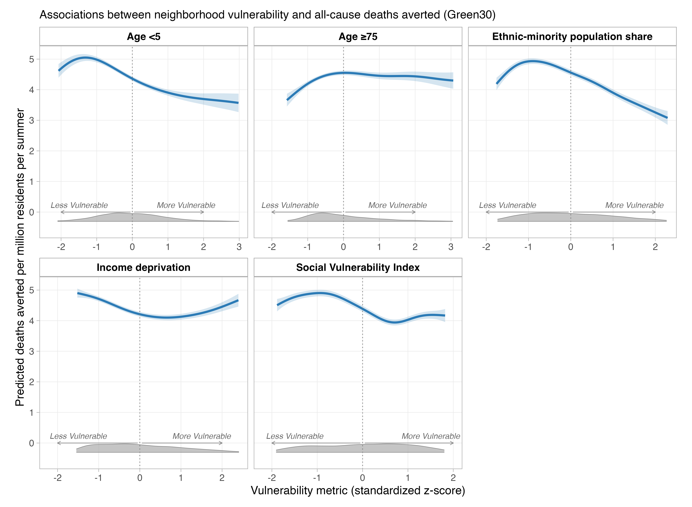
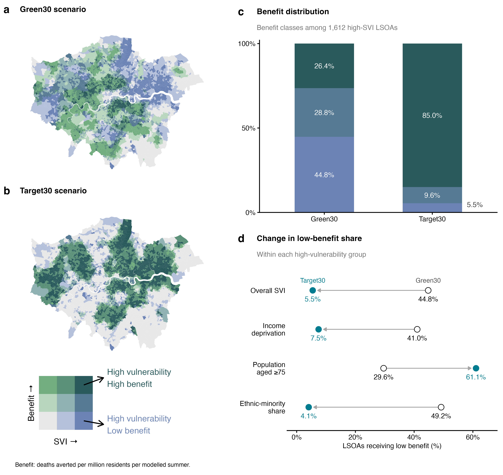

# Figures 6 and 7: seasonal-health manuscript text

Updated from the saved Word-revision draft to match **Figure 6 seasonal v2** and **Figure 7 seasonal v5**. This is the canonical editable source; [HTML](FIGURES6_7_MANUSCRIPT_TEXT.html) is generated from it. Word and figures are unchanged. Earlier annual wording remains available in Git history; annual-to-seasonal comparisons remain in the [technical report](seasonal_health_rerun_comparison.md).

## Contents

- [Proposed manuscript Results](#results)
- [Figure 6 and legend](#figure-6-legend)
- [Figure 7 and legend](#figure-7-legend)
- [Supplementary Fig. S6-1 legend](#supplementary-figure-s6-1-legend)
- [Extended Data Fig. 3 legend](#extended-data-figure-3-legend)
- [Supplementary Fig. S7 legend](#supplementary-figure-s7-legend)
- [Checks and figure sources](#checks-and-figure-sources)

## Results

### General greening yields uneven neighbourhood health benefits

Generalized additive models (GAMs) showed similar, non-linear patterns of modelled seasonal health benefits across Green10, Green20 and Green30, with Green30 shown as an illustrative scenario (Fig. 6; Supplementary Fig. S6-1). Benefits were lower at high than at low income deprivation and ethnic-minority population share. Under Green30, predicted deaths averted per million residents per modelled summer were respectively 0.58 and 1.19 lower at the 90th than the 10th percentile. Income-deprivation curves declined before partially recovering, whereas ethnic-minority-share curves peaked below the citywide mean and then declined. Higher overall SVI and under-five population share also corresponded to lower benefits in these percentile comparisons across all three Green scenarios.

By contrast, the 90th–10th percentile contrast for the proportion of residents aged ≥75 was positive across Green scenarios (+0.27 deaths averted per million residents per modelled summer under Green30). The Green30 curve rose initially before declining at higher older-population shares, rather than increasing monotonically. These citywide patterns describe neighbourhood-level benefit distributions, not age-specific mortality responses or causal effects of vulnerability. In a focused spatially adjusted check, Green30's negative associations with ethnic-minority share and overall SVI persisted, whereas the income-deprivation contrast was close to zero and its model-conditional interval included zero.

### Targeting redistributes benefits across vulnerability dimensions

Targeted greening altered these distributional patterns. Across Target10, Target20 and Target30, all five 90th–10th percentile contrasts reversed direction relative to the corresponding Green scenarios (Extended Data Fig. 3). Benefits were higher at the 90th than the 10th percentile of income deprivation, ethnic-minority population share, under-five population share and overall SVI, but lower for older-population share. The SVI contrast increased from +3.54 to +5.85 deaths averted per million residents per modelled summer from Target10 to Target30, compared with −0.31 to −0.65 under the corresponding Green scenarios.

The paired neighbourhood comparison quantified this redistribution for Green30 and Target30 (Fig. 7; Supplementary Fig. S7). Using fixed Green30 benefit thresholds, the proportion of high-SVI neighbourhoods receiving low benefits fell from 44.8% under Green30 to 5.5% under Target30, while the high-benefit share rose from 26.4% to 85.0%. In contrast, among neighbourhoods with the highest proportions of residents aged ≥75, the low-benefit share increased from 29.6% to 61.1%. Total deaths averted in this older-population group were also 17.1% lower under Target30 than Green30, despite both scenarios providing benefits relative to baseline. Targeting therefore improved alignment with composite vulnerability while revealing a trade-off for neighbourhoods with older populations. SVI is related to the targeting design, so its improved alignment is not an independent validation of the intervention.

## Figure 6 legend

**Fig. 6 | Neighbourhood vulnerability and modelled seasonal health benefits under Green30.** Green30 represents a 30% relative increase in tree-canopy cover and illustrates general greening; scenario comparisons appear in Supplementary Fig. S6-1 and Extended Data Fig. 3. Curves show separate univariable GAM predictions of all-cause heat-related deaths averted per million residents per modelled June–August summer across 4,835 London Lower Layer Super Output Areas (LSOAs). Benefits compare Green30 with baseline land use under WorldClim-aligned SSP370 conditions for 2041–2060, holding 2021 population and mortality fixed and allocating borough mortality by population. Vulnerability metrics, including the four-dimension Social Vulnerability Index (SVI; Methods), are standardized z-scores; vertical dotted lines mark citywide means. Blue lines show full predictions, including the intercept, from robust scaled-t GAMs fitted by restricted maximum likelihood. Shading indicates pointwise 95% model-conditional intervals. Grey densities show predictor distributions independently of mortality units; arrows indicate lower to higher vulnerability. All LSOAs enter the fits; curves display the 1st–99th percentiles. These are unadjusted citywide associations; intervals exclude spatial dependence and upstream input uncertainty.

## Figure 7 legend

**Fig. 7 | Redistribution of modelled seasonal health benefits under targeted greening.** **a,b,** Bivariate maps of four-dimension SVI and all-cause deaths averted per million residents per modelled summer under Green30 (a) and Target30 (b). Analyses pair 4,835 London LSOAs under the same WorldClim-aligned SSP370 conditions for 2041–2060, relative to baseline land use, with 2021 population and mortality fixed. Vulnerability tertiles are identical across scenarios. Green30 benefit thresholds—low ≤3.5062, moderate >3.5062–5.0539 and high >5.0539 deaths averted per million residents per modelled summer—are held fixed for Target30 (rounded for display). **c,** Benefit distribution among the same 1,612 high-SVI LSOAs, with low, moderate and high classes stacked bottom to top using map-key colours. **d,** Low-benefit shares within each displayed indicator's highest-vulnerability tertile; open and filled circles denote Green30 and Target30, respectively, and arrows indicate change. Percentages describe neighbourhoods, not residents; groups overlap. Classes indicate relative benefit, not absence of benefit, and age indicators describe neighbourhood composition rather than age-specific mortality. Panels c–d are descriptive.

## Supplementary Figure S6-1 legend

**Supplementary Fig. S6-1 | Neighbourhood vulnerability and modelled seasonal health benefits under general greening.** Dotted, dashed and solid green curves represent Green10, Green20 and Green30. Panels show population shares aged <5 and ≥75 and ethnic-minority share (top row), and income deprivation and four-dimension SVI (bottom row). Curves are full fitted predictions, including the intercept, from separate robust scaled-t GAMs fitted by REML across 4,835 London LSOAs. Benefits are all-cause deaths averted per million residents per modelled June–August summer relative to baseline land use under WorldClim-aligned SSP370, 2041–2060 conditions, with 2021 population and mortality fixed and borough deaths allocated by population. Shading shows pointwise 95% model-conditional intervals. Predictors are standardized z-scores; dotted vertical lines mark citywide means, arrows indicate vulnerability direction, and grey densities show predictor distributions on an independent scale. All LSOAs enter the fits; curves display P1–P99. Y-axis ranges differ between indicators but are shared across scenarios within each panel. Associations are unadjusted for location; intervals exclude spatial dependence and upstream uncertainty.

## Extended Data Figure 3 legend

**Extended Data Fig. 3 | Neighbourhood vulnerability and modelled seasonal health benefits under targeted greening.** Dotted, dashed and solid purple curves represent Target10, Target20 and Target30. Panel order, population and mortality inputs, seasonal outcome, climate reconstruction and GAM specification match Supplementary Fig. S6-1. Curves show full fitted all-cause deaths averted per million residents per modelled summer; shading indicates pointwise 95% model-conditional intervals. Grey densities show predictor distributions independently of mortality units, and arrows indicate vulnerability direction. All 4,835 LSOAs enter the fits; curves display P1–P99. Y-axis ranges differ between indicators but are shared by the three scenarios within each panel. Associations are unadjusted for location; intervals exclude spatial dependence and upstream uncertainty.

## Supplementary Figure S7 legend

**Supplementary Fig. S7 | Spatial distribution of modelled seasonal health benefits across vulnerability indicators.** **a,b,** Bivariate maps under Green30 (a) and Target30 (b) for overall SVI, income deprivation, population aged ≥75, ethnic-minority share and population aged <5. Benefits are all-cause deaths averted per million residents per modelled summer under the same climate reconstruction and fixed 2021 population and mortality as Fig. 7. Metric-specific vulnerability tertiles and seasonal Green30 benefit thresholds (3.5062 and 5.0539) are held fixed across both scenarios for all 4,835 LSOAs. Blue indicates high vulnerability and relatively low benefit. Age indicators describe neighbourhood composition, not age-specific mortality; SVI is related to targeting design, not an independent validation measure.

## Checks and figure sources

- **Keep Green and Target separate:** the Results retain the earlier Word-revision structure. Seasonal rates replace annual rates; no annual uncertainty estimates have been imported.
- **Interpretation:** P90–P10 contrasts compare two predictor values, not the entire curve. Income deprivation and older-population share should not be described as monotonic responses. The seasonal spatial check used k = 100 only, not a repeated k = 50/100/200 suite.
- **Numbering:** retain Supplementary Fig. S6-1 (Green overlay), Extended Data Fig. 3 (Target overlay) and Supplementary Fig. S7 (map-only supplement). S6-2 remains retired.
- **Main figure generator:** [plot_seasonal_manuscript_figures.R](../../code/health_assessment/plot_seasonal_manuscript_figures.R), reusing the layouts in [equity-health.Rmd](../../code/equity-health.Rmd) and [equity-health-fig7-production.Rmd](../../code/equity-health-fig7-production.Rmd).
- **Supplement generator:** [plot_seasonal_supplement_figures.R](../../code/health_assessment/plot_seasonal_supplement_figures.R).
- **Statistics:** [compare_seasonal_health_equity.R](../../code/health_assessment/compare_seasonal_health_equity.R); saved GAM contrasts and paired classes in the completed seasonal run. Exact output locations, numerical checks and assumptions remain in the [seasonal-health report](seasonal_health_rerun_comparison.md#files-and-scripts), not repeated here.
