# Four-dimension SVI and Figure 6 spatial sensitivity

The 12 inline graphics are versioned illustrations of this research report.
Rebuild the diagnostic panels with `Rscript code/run_figure6_spatial.R`, then
the two overview charts with `python code/plot_svi_spatial_report.py`. See the
[release review](../../DATA_LICENCE_AND_REDISTRIBUTION.md). Figure 6 rates
are reported per million residents (ten times the original per-100,000
reporting scale); Figure 4 totals and Figure 7 classifications are unchanged.

## Figure attribution and reuse

These rendered statistical summaries and residual maps are shared as part of
a non-commercial research report, not as source land-cover data or downloadable
geospatial datasets. See the [release decision](../../DATA_LICENCE_AND_REDISTRIBUTION.md#rendered-report-figures-review-4-november-2026).
The repository's GPL code licence does not grant rights to third-party data
or unrestricted reuse of these illustrations. Retain this attribution when
sharing the report or its figures; no commercial-use rights are granted here.

Land-cover input to the Figure 6 modelling: Morton, R.D.; Marston, C.G.;
O'Neil, A.W.; Rowland, C.S. (2024). *Land Cover Map 2023 (10m classified
pixels, GB).* NERC EDS Environmental Information Data Centre.
[doi:10.5285/7727ce7d-531e-4d77-b756-5cc59ff016bd](https://doi.org/10.5285/7727ce7d-531e-4d77-b756-5cc59ff016bd).
Data owned by UK Centre for Ecology & Hydrology.
© Database Right/Copyright UKCEH.

Vulnerability data: Greater London Authority and Bloomberg Associates,
Climate Risk Mapping 2024 (OGL v3), rescored for this analysis. Mortality:
Source: Office for National Statistics (OGL), modelled through the health
workflow. Population: Bondarenko et al. (2025), UK 2021 population counts,
R2025A v1, [doi:10.5258/SOTON/WP00839](https://doi.org/10.5258/SOTON/WP00839)
(CC BY 4.0), reprojected and aggregated. Residual-map boundaries: Contains
National Statistics data © Crown copyright and database right [2015].
Contains Ordnance Survey data © Crown copyright and database right [2015].
Source links and transformation provenance are in the
[derived-data guide](../../data/derived/README.md).

## Which score changed?

The reference is the author's existing `overall_score` in the versioned
vulnerability layer, not a newly fitted index. Six London LSOA indicator
percentile ranks form four themes: income deprivation; household (age <5,
age ≥75, limited English proficiency); ethnic composition; and social housing.
The scoring notebook averages available components within themes and then
averages the four theme scores with equal theme weights. A higher value
indicates greater relative vulnerability. Do not include the already-aggregated
`overall_pct` as another component.

Figure 2 now matches this score by area ID and verifies neighbourhood names.
Figures 6 and 7 already read the same layer's `overall_score`; no changes to
their vulnerability scores, health outcomes or Figure 7 thresholds were needed.
Figure 2 retains quintiles; Figure 6 models the score continuously, and
Figure 7 uses tertiles. Different categories do not imply a different index.

Across 4,835 matched LSOAs, recomputing the four-theme average reproduced the
stored score to machine precision (maximum absolute difference 1.11e-16).
The **former Figure 2 reconstruction**, which included seven percentile columns,
correlated 0.977 with the stored score; mean absolute score difference was
0.039 on the 0–1 scale. Exactly 1,052 areas moved by one quintile; none moved
farther. The highest quintile retained 828 of 967 members. The earlier 2,200
figure compared against a hypothetical four-*indicator* score, not the
approved four-*theme* score.

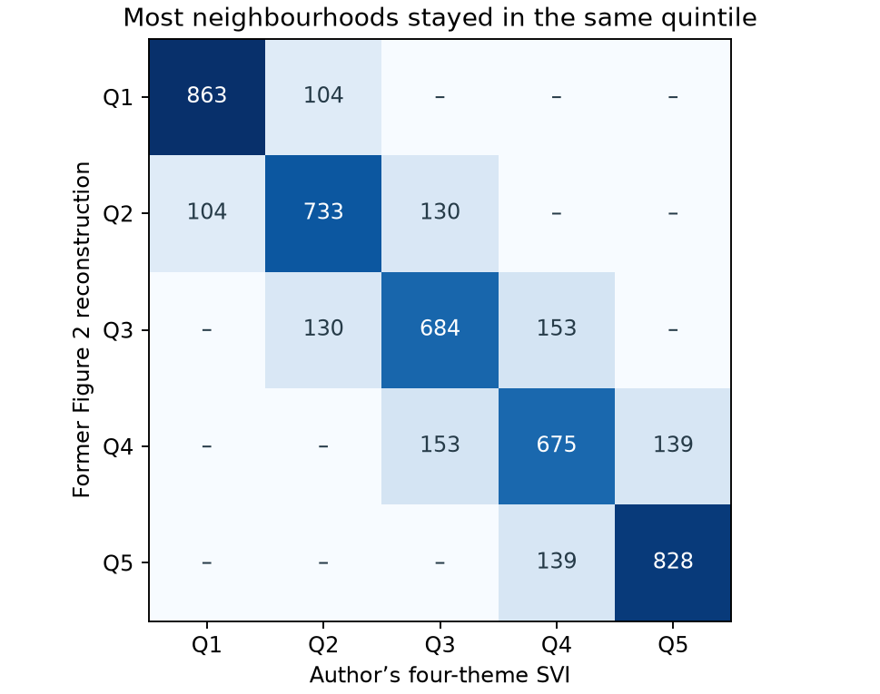

Read across a row to see where each former quintile went. The diagonal counts
areas that stayed in the same quintile; dashes mean zero. For example, 828
former Q5 areas stayed in Q5 and 139 moved to Q4.

| Figure 2 outcome, median | Former Q1 → Q5 | Author's score Q1 → Q5 |
|---|---:|---:|
| July temperature change (°C) | 3.92 → 3.99 | 3.86 → 4.00 |
| Tree cover (%) | 17.99 → 13.63 | 17.94 → 14.28 |

The high-versus-low direction is unchanged; neither comparison establishes a
strict dose-response relation or an individual-level effect. The four other
Figure 2 indicators do not use the composite to define their quintiles.

## Spatial sensitivity: what it tests

The descriptive GAM asks how modelled Green30 all-cause deaths averted per
million residents vary across London with each vulnerability indicator. The adjusted GAM
asks how much of that association remains after fitting a smooth geographic
pattern. For example, if high-vulnerability areas cluster where simulated
cooling is largest, their greater citywide benefit is real *in the model*
even if there is little additional gradient after location is held fixed.
This is not causal adjustment, a literal matched-neighbour analysis, or
uncertainty propagation through the health model.

`code/run_figure6_spatial.R` uses the same 25 °C Green30 sample, standardization,
scaled-t GAM family and REML smoothing as the primary analysis. The spatial
term uses representative-point coordinates (British National Grid, km);
k = 50, 100 and 200 are pre-specified sensitivity settings, not three models
from which to select by significance. Compare the fitted 90th-minus-10th
percentile contrast at fixed location, conditional 95% intervals, centred
curves, spatial overlap with vulnerability (concurvity), residual maps and
queen-contiguity residual Moran's I (999 permutations).

### What does changing `k` actually do?

Imagine drawing a map of the *background pattern* of cooling benefits across
London. A broad brush can show a gradual difference between one side of the
city and the other. A finer brush can also follow smaller pockets of high or
low benefit. **`k` limits how much detail the map is allowed to show**; it
does not force the model to paint every possible detail. **Bigger `k` permits
a finer brush: 50 is the broadest of our three settings, 100 is intermediate,
and 200 permits the finest detail.** This describes the fitted background map,
not the vulnerability curve itself; the latter can actually become flatter
once finer geographic patterns are accounted for. The fitting procedure
penalizes unnecessary wiggles. It uses the same 4,835 neighbourhoods each time:
`k = 100` does **not** mean 100 neighbourhoods, 100 km, or 100 clusters.

| Label in the plots | What changes | SVI contrast: high minus low |
|---|---|---:|
| No spatial adjustment | No background map; the citywide comparison. | −9.84 |
| Spatial: k = 50 | Allow a broad spatial pattern. | −2.76 |
| Spatial: k = 100 | Allow more local detail. | −1.64 |
| Spatial: k = 200 | Give the map still more flexibility. | −0.84 |

Here “high minus low” means the predicted difference between the 90th and
10th SVI percentiles, in deaths averted per million residents. At 50, some broad
geographic differences are already accounted for. At 200, more of the
variation can be represented by location, leaving a smaller SVI contrast.
The benefit received by any neighbourhood has **not** changed.

**Why these three numbers?** We chose a simple doubling sequence before
comparing the fits: 50 as the lower setting, 100 as the middle illustration,
and 200 as a check on whether the conclusion depends on allowing more detail.
They were not estimated from the data, preregistered thresholds, or three
known geographic scales. Only the *map* changed flexibility; the separate
vulnerability curve retained the same setting in every fit.

**Is there a usual range?** There is no universal recommended range. For
orientation, the standard two-coordinate thin-plate smooth in `mgcv` defaults
to about 30; that is a software starting point, not a London-specific rule.
Too small a limit can leave real spatial structure unmodelled. Increasing it
costs more computing time and can make it harder to separate a geographically
clustered indicator from location. A sensible check is to increase the limit,
compare the contrast, and see how much residual clustering remains. Here the
*direction* for SVI is stable, but its magnitude is sensitive and clustering
persists. We therefore report the range rather than declare 100 or 200 “best.”
See the [basis-size guidance](https://stat.ethz.ch/R-manual/R-devel/library/mgcv/html/choose.k.html)
and [default for the spatial smooth](https://stat.ethz.ch/R-manual/R-devel/library/mgcv/html/smooth.construct.tp.smooth.spec.html).

## Findings (4,835 LSOAs per fit)

Contrast = predicted deaths averted per million residents at vulnerability P90 minus
P10. Negative means less benefit at high vulnerability. Intervals at k=100
are nominal, model-conditional intervals, **not** spatially validated tests.

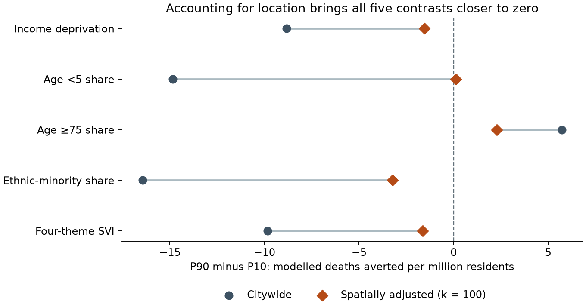

Each line connects two estimates for the **same** indicator and neighbourhoods,
not a change in benefit over time. Left of zero means less modelled benefit
at higher vulnerability. See the table for the other spatial settings and
conditional intervals; the graphic shows point estimates only.

| Indicator | Citywide | Spatial k=50 | Spatial k=100 (95% interval) | Spatial k=200 |
|---|---:|---:|---:|---:|
| Income deprivation | −8.83 | −2.33 | −1.54 (−2.19, −0.90) | −0.83 |
| Age <5 share | −14.85 | −0.69 | 0.11 (−0.48, 0.71) | −0.14 |
| Age ≥75 share | 5.73 | 3.41 | 2.27 (1.47, 3.08) | 1.82 |
| Ethnic-minority share | −16.45 | −5.40 | −3.23 (−4.15, −2.32) | −1.62 |
| Four-theme SVI | −9.84 | −2.76 | −1.64 (−2.31, −0.97) | −0.84 |

All unadjusted contrasts reproduced the prior export within 1e-6 after unit conversion. Accounting
for geography substantially attenuates all five contrasts; the under-five
gradient is close to zero and its sign is unstable. The SVI contrast retains
its sign but decreases from nearly ten fewer deaths averted per million residents to
1.64 fewer at k=100. This is compatible with much of the observed inequality
tracking geography; it does not quantify a causal fraction explained by location.
The ethnic-composition smooth has the greatest overlap with the spatial term
(estimated concurvity 0.66 at k=100, 0.73 at k=200).

Residual Moran's I falls from 0.891–0.941 unadjusted to 0.737–0.743 at k=100
and 0.579–0.591 at k=200 (all permutation p=0.001). **Spatial dependence
persists.** Keep Figure 6 as descriptive evidence of the distribution of
modelled benefits; do not claim independent effects of vulnerability or use
these conditional intervals to establish significance. Figure 7's comparative
Target/Green result is not tested or changed by this Green30 sensitivity.

## Visual guide to the diagnostic figures

Select any curve or map below to enlarge it.

**Left: read each curve from low to high vulnerability.** The horizontal axis
measures distance from the London mean in standard deviations (0 = average).
The vertical axis is the indicator's centred contribution: zero does not mean
zero deaths averted. On each coloured curve, the **circle** marks P10 (low
vulnerability) and the **triangle** marks P90 (high vulnerability). Read from
the circle to the triangle on the *same colour*: the triangle’s height minus
the circle’s height is the contrast reported above. If the triangle is lower,
the fitted benefit is smaller at P90. These are predictor percentiles, not
confidence limits. The line between and beyond them shows what a two-point
comparison leaves out. Marker positions interpolated from the saved curves
reproduce the model contrasts to within 0.01 death averted per million residents.

**Right: look for patches of similar colour.** Each dot represents one LSOA.
Blue means the model underestimated its benefit; red means it overestimated
it (signed deviance residuals, not death counts). White is near zero.
Each four-panel map uses one colour scale for that indicator. Read from
“No spatial adjustment” through k = 50, 100 and 200: broad patches become less
apparent, but adjacent dots still often share a colour. The Moran's I values
above quantify what the maps suggest.

### Income deprivation

The unadjusted curve bends sharply. The adjusted curves are flatter; the P90-minus-P10 contrast changes from −8.83 to −0.83 at `k = 200`.

| Vulnerability curves | Residual maps |
|---|---|
| [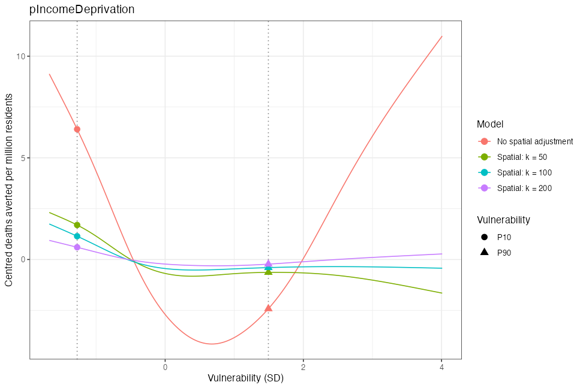](figure6_diagnostic-01.png) | [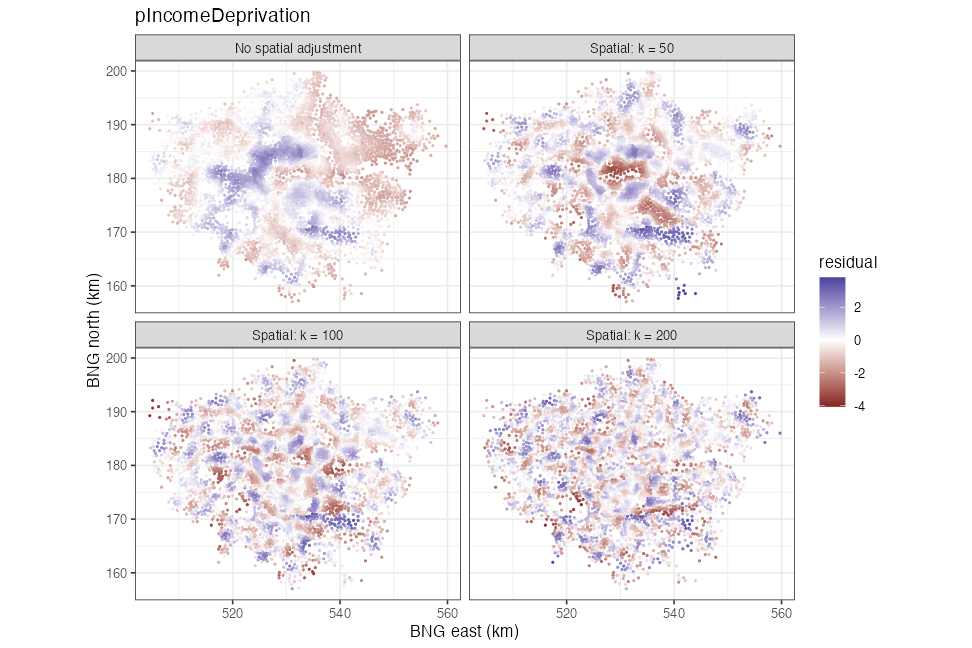](figure6_diagnostic-02.png) |

### Share aged under five

The unadjusted contrast is −14.85. After adjustment it is close to zero at all three settings, even though some curves still bend at the extremes.

| Vulnerability curves | Residual maps |
|---|---|
| [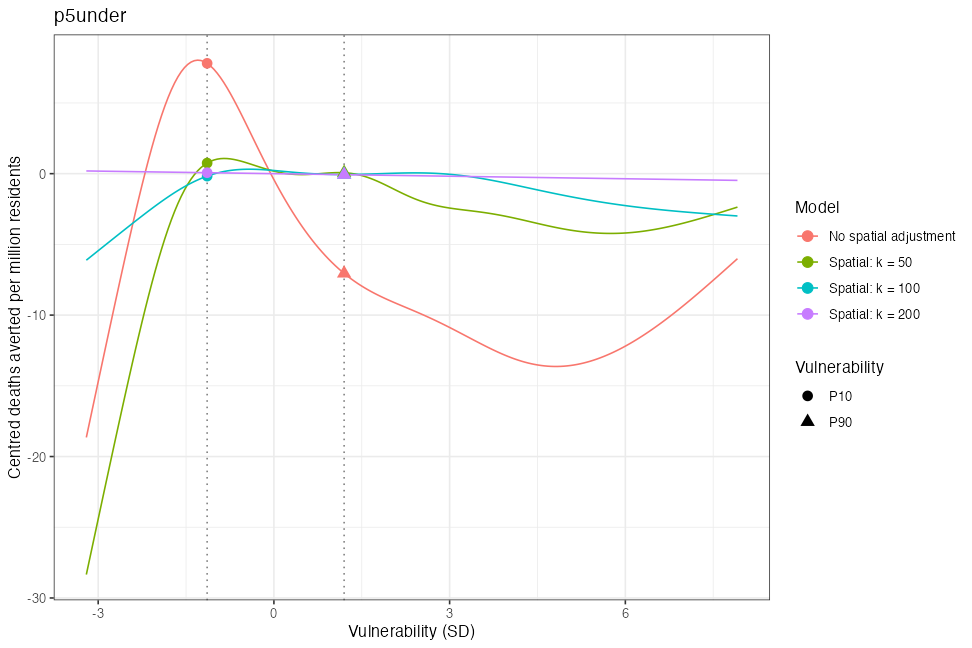](figure6_diagnostic-03.png) | [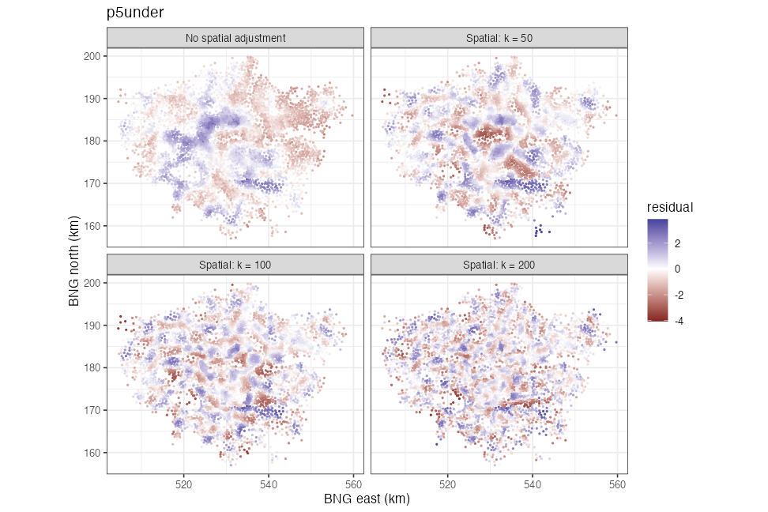](figure6_diagnostic-04.png) |

### Share aged 75 or older

The contrast remains positive: +5.73 without adjustment and +1.82 at `k = 200`. This describes areas with different age compositions, not the effect on an individual older resident.

| Vulnerability curves | Residual maps |
|---|---|
| [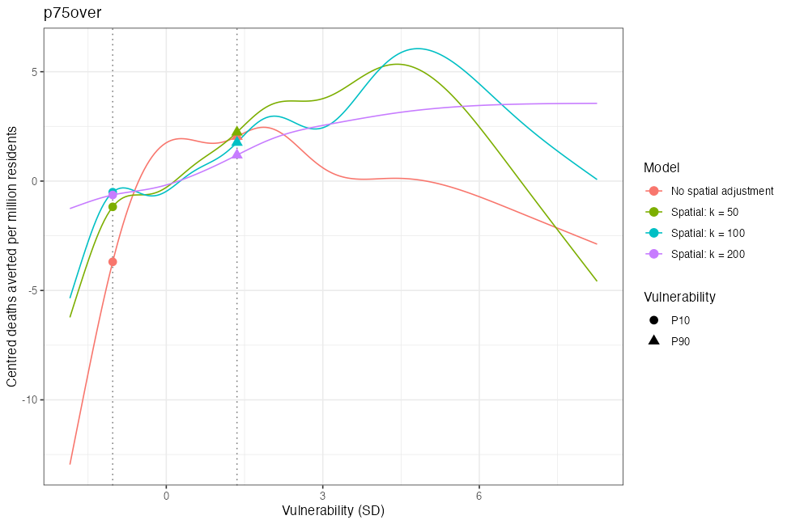](figure6_diagnostic-05.png) |  |

### Ethnic-minority population share

The negative contrast shrinks from −16.45 to −1.62 at `k = 200`. Of these indicators, this one overlaps most strongly with the fitted geographic pattern.

| Vulnerability curves | Residual maps |
|---|---|
| [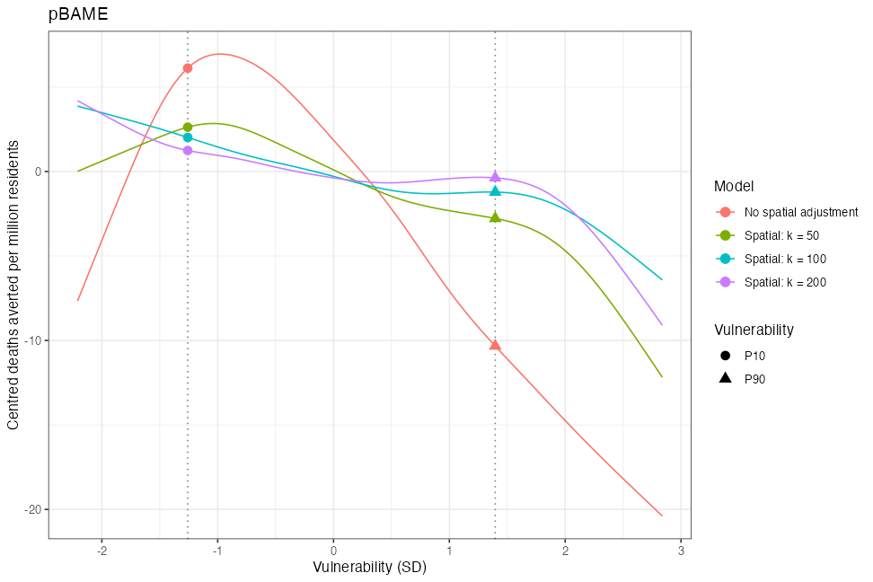](figure6_diagnostic-07.png) | [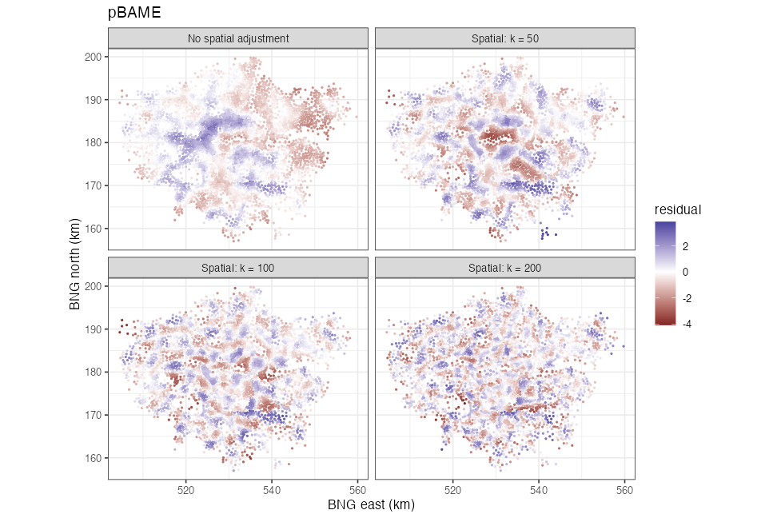](figure6_diagnostic-08.png) |

### Four-theme SVI

The unadjusted curve shows a pronounced difference across London. All three adjusted curves are flatter; the coloured patches on the residual maps show why even the most flexible fit is not a complete spatial correction.

| Vulnerability curves | Residual maps |
|---|---|
| [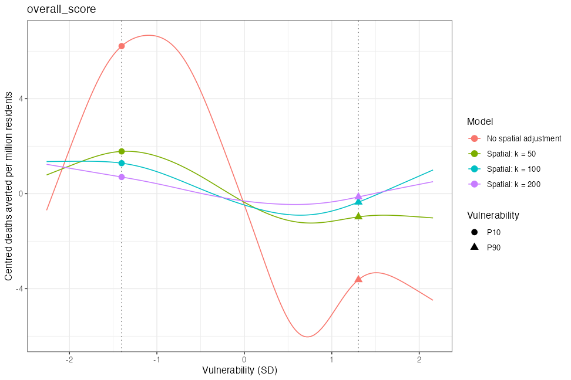](figure6_diagnostic-09.png) | [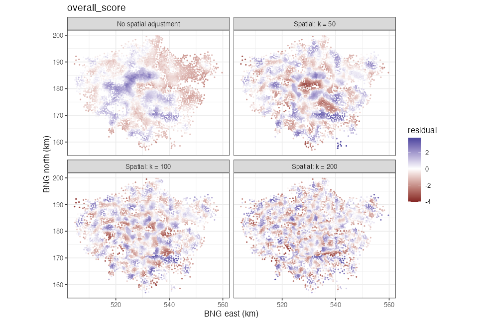](figure6_diagnostic-10.png) |

Local output: [full contrasts and diagnostics](../../figures/figure6_statistical_reporting/figure6_spatial_stats.csv).
