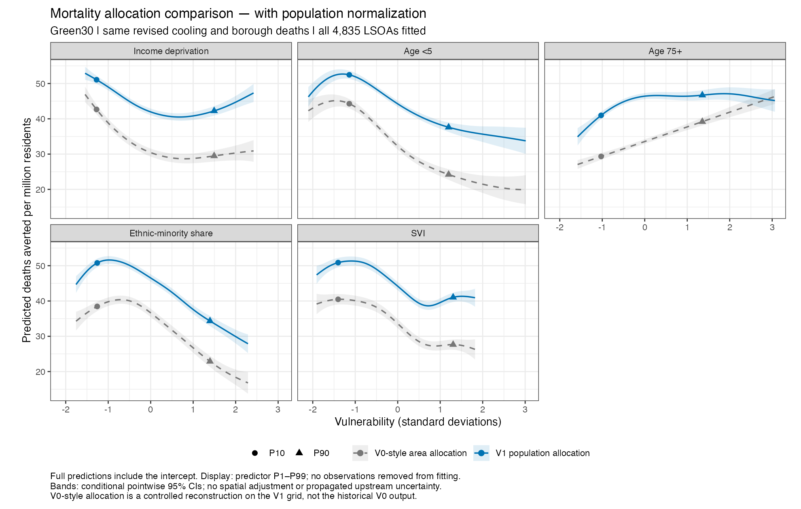
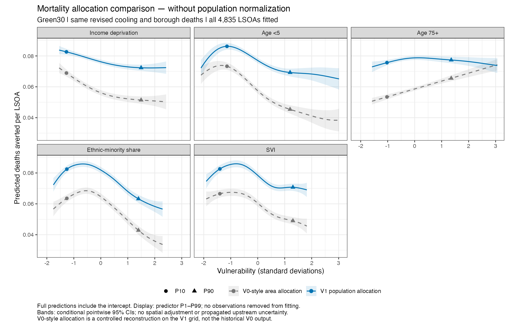
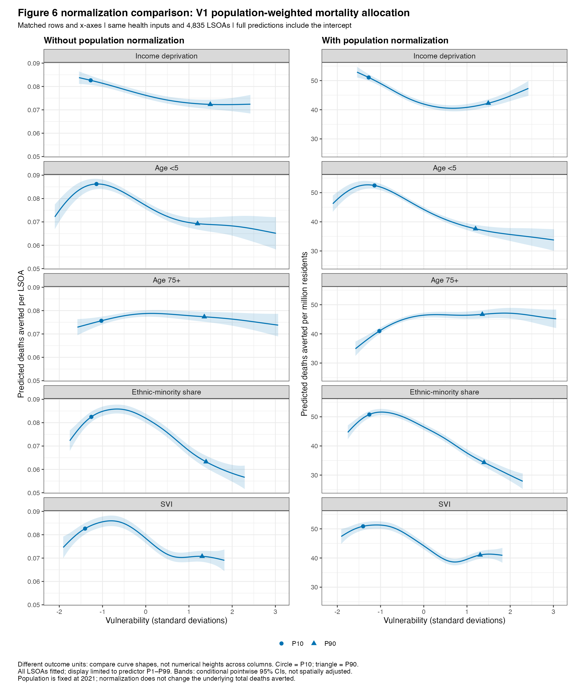
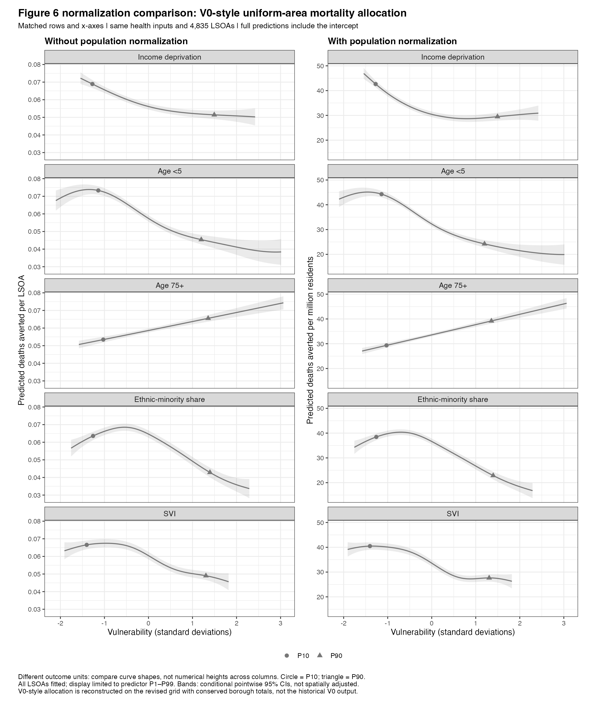

# V0 and V1 health analysis and Figure 6 changes

Updated: 5 November 2026.

This decision record explains three major changes relevant to Figure 6:
health inputs, population normalization, and the presentation of GAM predictions.
It is a comparison and rationale, not a second reproduction guide.

## Version definitions and current status

- **V0:** the earlier analysis represented by the historical health table and
  Green30 Figure 6. For the controlled comparison, the code reference is commit
  `95383f8` and the figure reference is the 8 August 2026 Green30 version.
- **V1:** the current revision programme since July 2026, including the revised
  health pipeline and subsequent Figure 6 updates through this document's date.
  V1 is a project revision label, not an InVEST version or a single frozen commit.

These labels are analytical versions, not a strict before/after July division:
the available V0 reference figure is dated August. Its exact image-producing
runtime was not archived. The recovered historical health CSV agrees with the
cached historical cases, and the comparison verified matching predictors and
neighbourhood polygons.

**Implemented:** revised health inputs, population normalization, validated
neighbourhood matching, the full valid sample and intercept-inclusive candidate
figures for both allocations. Earlier centered figures are preserved. Final
main/SM selection remains with the author. See the
[candidate figures and draft text](FIGURE6_REVIEW_DRAFTS.md) for the current
review versions, legends, Results and Figure 7 consistency checks.

## 1. Revised health inputs

The numerator—modelled deaths averted in each neighbourhood—changed before
population normalization was applied.

| Component | V0 | V1 and decision rationale |
|---|---|---|
| Mortality allocation | Borough deaths distributed uniformly by land area | Allocate in proportion to 2021 pixel population, preserving borough death totals and placing the burden where residents live. |
| Population preprocessing | Bilinear resampling of population counts did not conserve totals | Count-preserving resampling onto the UCM grid supplies the mortality-allocation weights. |
| Temperature inputs | Historical UCM outputs | Consistent InVEST 3.20.2 production runs incorporate corrected park cooling and grid alignment; baseline and intervention must use the same workflow. |
| Green30 configuration | Historical scenario-generation settings | Regenerated, nested Green scenarios use common eligible planting classes and consistent NoData. Green30 retains 894,249 eligible added-canopy cells, but their locations can differ. |
| LSOA aggregation | Historical zonal sums | Checked aggregation with explicit boundary-cell handling and conservation of health-raster totals. |

The revised allocation is:

```text
Pixel baseline deaths = borough registered deaths
                      × pixel 2021 population / borough 2021 population
```

Population weighting does not change the observed borough death total. It
assumes equal cause-specific mortality per resident within each borough;
pixel-level deaths remain modelled allocations, not observations. Within-borough
age and health-risk differences are not resolved by this allocation.

The Figure 6 comparison replaces the historical
`health_london_45_zonal_stats_long_LSOA_2050_2050.csv` with
[`health_lsoa_fig7_revised_equal_area_population_weighted_2021.csv`](../../data/derived/health_lsoa_fig7_revised_equal_area_population_weighted_2021.csv),
selecting Green30, all-cause mortality and the primary 25°C setting. The
[input manifest](../../data/derived/health_lsoa_fig7_revised_equal_area_population_weighted_2021.manifest.json)
records source rasters and aggregation checks.

Detailed justification belongs in the existing
[health-method decisions](../../code/health_assessment/DATA_SELECTION_AND_METHOD_DECISIONS.md),
[UCM version audit](../../code/Urban_Cooling_Modeling_Runs/INVEST_VERSION_COMPARISON.md)
and [land-cover scenario guide](../../code/lc_scenarios/README.md).
The UCM audit's historical Target30 temperature differences should not be
interpreted as a numerical decomposition of the Green30 Figure 6 changes.

## 2. Population normalization of the Figure 6 outcome

```text
V0 outcome = total modelled deaths averted in an LSOA
V1 outcome = LSOA deaths averted / LSOA 2021 population × 1,000,000
```

V0 asks which neighbourhoods receive more total benefit. V1 asks which receive
more benefit per resident, reducing the influence of neighbourhood population
size. For example, 0.10 deaths averted among 1,000 residents equals 100 per
million; the same 0.10 among 2,000 residents equals 50 per million.

This is separate from population-weighted mortality allocation: allocation
constructs the health numerator upstream; normalization defines the outcome
compared between neighbourhoods downstream. Neither operation means that the
GAM is population-weighted: each LSOA remains one observation.

The denominator is the count-preserved **2021** population, not a future
projection. The model fits rates per 100,000 internally and exports them per
million; that final multiplication by ten changes units only. In contrast,
dividing LSOA totals by their varying populations can change curve shape.
Citywide total deaths averted remain appropriate for Figure 4.

## 3. Full predictions versus centered smooth contributions

For the main single-predictor GAM with an identity link:

```text
Full fitted outcome = intercept + centered vulnerability smooth
```

V0 included the intercept, although its legend described a centered effect.
The current V1 display uses `type = "terms"`, which excludes the intercept and
therefore genuinely plots centered contributions. A negative contribution
does not mean negative deaths averted; it means a negative contribution to
the fitted outcome relative to the model intercept.

For illustration, an intercept of 40 and smooth values of +10 and −5 produce
full predictions of 50 and 35 deaths averted per million. Both presentations
have the same between-point difference of −15. For the same fitted model,
including the intercept shifts the curve vertically without changing its
shape or P90–P10 contrast. Full-prediction confidence intervals must include
intercept uncertainty and covariance; existing smooth-only bands cannot
simply be relabelled.

**Decision:** return to the intuitive V0 presentation style for the main figure,
but retain the V1 data, normalization and models. Use the axis label
“Predicted deaths averted per million residents.” Describe fitted GAM predictions
and their 95% confidence intervals in the legend, removing the centered-effect
wording. The GAM is not constrained to positive predictions; any negative
fitted values require inspection, not clipping.

For spatial-sensitivity plots, retain centered vulnerability contributions
with explicit labels. Full predictions from a spatial model also contain a
location-dependent term and require a stated reference location or averaging
procedure. See the [spatial interpretation report](SVI_SPATIAL_RESULTS.md).

## Evidence and limits of the controlled comparison

The [comparison script](../../code/compare_figure6_versions.R) fits all eight
combinations of old/revised inputs, totals/rates and trimmed/full samples for
five predictors: 40 fits. It holds vulnerability values, predictor scaling,
GAM settings and full-sample P10/P90 reference points fixed. Current-model
contrasts reproduce the saved Figure 6 results within numerical precision.

- Revised inputs most clearly alter the age ≥75 shape: with normalized rates
  and trimming fixed, the P90–P10 contrast changes from +11.03 to +5.41 deaths
  averted per million.
- Normalization largely preserves the historical shapes but changes the
  estimand and strengthens standardized central contrasts.
- Retaining all valid LSOAs changes the revised central contrasts by only
  0.07–0.49 deaths per million, without reversing their directions; tail shapes,
  especially for age <5, remain more sensitive.
- Validated matching identifies no historical mismatch in this comparison;
  genuine centering changes vertical position, not shape.

Numerical tables, separate diagnostic PNGs and preservation checks are in the
local [version comparison folder](../../figures/figure6/version_comparison/).
Those diagnostics use a shared central predictor range and reference curves
to P50 to remove arbitrary vertical offsets; they are not replacement
manuscript figures.

The input replacement is a bundle of upstream changes, not a separate estimate
of each component's contribution. Factor effects can interact and depend on
comparison order; no percentage decomposition of the overall change is claimed.
These are unadjusted citywide associations, not causal effects or spatially
adjusted estimates. No manuscript or production figure was changed;
new sensitivity models are saved separately.

## Controlled mortality allocation and normalization figures

### Design and meaning of V0-style

This follow-up holds fixed the revised Green30 temperature rasters, all-cause
relative risk (1.02 per °C), 2021 borough death totals, raster grid, LSOA
aggregation, vulnerability values and full sample. Area allocation distributes
each borough total equally among its 10 m cells; population allocation uses
the production population-weighted mortality raster. Both preserve borough
totals and both have complete temperature coverage.

**V0-style is a controlled reconstruction, not the exact archived V0 output.**
Equal-area cells preserve totals without importing historical resampling losses
into the allocation comparison. Area allocation includes cells with zero mapped
population; neither method is reweighted after a population or temperature mask.
The population-allocation results match the current V1 input to less than
0.000001 deaths per LSOA.

Each method is fitted both as deaths per LSOA and as deaths per million
residents. All 4,835 LSOAs enter each robust GAM; only the displayed predictor
range is restricted to P1–P99. Curves include the intercept, circles mark P10,
triangles mark P90, and bands are conditional pointwise 95% confidence intervals.
They omit spatial dependence and upstream uncertainty. None of the displayed
fitted curves has negative predictions.

### With population normalization



Blue is population allocation; grey dashed is uniform-area allocation.
Population allocation flattens the age-75+ relationship at higher values and
weakens the P90–P10 contrasts for deprivation, age <5 and SVI. The ethnic-minority
contrast is slightly more negative. All five central contrast directions are
retained, but this does not imply identical curve shapes.

### Without population normalization



These curves show total benefit per neighbourhood, not benefit per resident.
The population-allocation age-75+ curve is nearly flat across P10–P90 in total
units; normalization yields a clearer positive central contrast. Numerical
heights cannot be compared between these images because the outcome units differ.

Individual versions:

| Allocation | Without normalization | With normalization |
|---|---|---|
| V0-style uniform area | [Deaths per LSOA](../../figures/figure6/allocation_normalization_comparison/figure6_v0_style_area_total.png) | [Deaths per million](../../figures/figure6/allocation_normalization_comparison/figure6_v0_style_area_rate.png) |
| V1 population | [Deaths per LSOA](../../figures/figure6/allocation_normalization_comparison/figure6_v1_population_total.png) | [Deaths per million](../../figures/figure6/allocation_normalization_comparison/figure6_v1_population_rate.png) |

### Side-by-side normalization comparison

Each row below shows the same vulnerability measure. The left column uses
total deaths averted per LSOA; the right uses deaths averted per million
residents. Allocation, health inputs and fitted sample are fixed within each
image. The x-axes match, but the y-axis units differ: compare shapes rather
than numerical heights across columns. Predictions include the intercept.

**V1 population-weighted allocation — the recommended main-analysis method:**



**V0-style area allocation — the controlled sensitivity method:**



These images use the existing saved curve predictions; no models were refitted.
The [side-by-side plotting script](../../code/plot_figure6_normalization_side_by_side.R)
reproduces them without replacing the preceding figures.

### Magnitudes and the role of other input changes

With revised cooling fixed, uniform-area allocation gives **361.64** citywide
deaths averted and population allocation gives **387.37**: **+25.74 (+7.12%)**.
Both allocate approximately 56,945 baseline registered deaths. Area allocation
assigns 4,050.29 baseline deaths (7.11%) to cells with zero mapped population;
population allocation assigns none. A population-raster zero does not prove
that no person ever occupies that cell, but uniform land allocation is a weaker
representation of the resident population at risk.

The sequence below separates allocation from the remaining input revisions.
All columns use rates per million, all valid LSOAs and identical P10/P90 points.
The historical column comes from the earlier eight-combination comparison,
not the original trimmed figure.

| P90–P10 contrast | Historical inputs, area allocation | Revised cooling/grid, V0-style area | Revised inputs, population allocation |
|---|---:|---:|---:|
| Income deprivation | −13.15 | −13.17 | −8.83 |
| Age <5 | −17.09 | −20.07 | −14.85 |
| Age ≥75 | +11.18 | +9.85 | +5.73 |
| Ethnic-minority share | −15.86 | −15.58 | −16.45 |
| Overall SVI | −13.35 | −12.84 | −9.84 |

**In this sequence, allocation produces the larger absolute contrast change
for each measure**, particularly deprivation and SVI. Other changes are not
negligible: for age <5 they shift the contrast by about −2.98, before allocation
shifts it by +5.21 in the opposite direction. For age ≥75, the respective shifts
are about −1.33 and −4.12. This supports allocation as an important driver of
these central contrasts, not a universal ranking for all curve features,
scenarios or citywide totals. The first transition bundles scenario/cooling,
grid, coverage and area-reconstruction differences; it does not isolate each
component. Interactions prevent a unique order-independent percentage attribution.

### Recommendation for manuscript reporting

Use **V1 population allocation for primary health results** and report V0-style
area allocation as a clearly labelled Supplementary sensitivity analysis.
Area allocation can be reported as an alternative assumption, but should not
replace the main method because it produces more familiar or stronger curves.
Dividing area-allocated benefits by population can also introduce a density
pattern: mortality is spread by land area while benefits are expressed per resident.

Population allocation is more consistent with a resident population at risk,
but assumes constant mortality risk per resident within each borough and
inherits population-raster uncertainty. Neither method recovers observed LSOA
mortality or resolves within-borough demographic risk differences. Retain
per-resident outcomes for the main Figure 6 and citywide totals for Figure 4;
total-per-LSOA curves can accompany the sensitivity material as a distinct
outcome rather than an alternative unit scale.

### Reproduction and preservation checks

Run from the repository root using the existing Python health environment and
R environment. The scripts refuse to overwrite existing comparison outputs.

```bash
python code/health_assessment/compare_figure6_allocation.py --data-root "$URBAN_COOLING_DATA_ROOT"
Rscript code/plot_figure6_allocation_comparison.R
Rscript code/plot_figure6_normalization_side_by_side.R
```

The [allocation script](../../code/health_assessment/compare_figure6_allocation.py)
and [GAM script](../../code/plot_figure6_allocation_comparison.R) save checksums,
conservation checks, city summaries, curve data and contrasts beside the PNGs
in the local [comparison folder](../../figures/figure6/allocation_normalization_comparison/).
Existing figure files are hash-checked for preservation. These sensitivity
figures are diagnostic comparisons, not replacements for the candidate
Figure 6 panels linked in the review pack.
