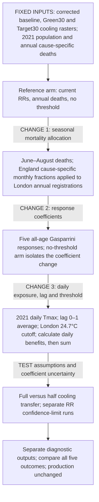

# Temperature–mortality responses: adopted inputs and supporting evidence

Updated 18 November 2026. The main Table 2 below reports the five Gasparrini coefficients adopted in the seasonal-health analysis. The earlier search and pilot record is preserved below as historical provenance, not as current implementation instructions. This is a targeted evidence compilation, not a systematic review. Supporting estimates are **not interchangeable**: exposure contrasts, outcome definitions and age coverage differ.

## Corrected main Table 2 — ready for manuscript use

[Download the separate Word table](table2_adopted_seasonal_health_responses.docx). Original manuscript unchanged.

**Table 2 | Exposure–response coefficients used to estimate heat-related mortality.** Relative risks (RRs) describe the change in mortality per 1°C increase above the London threshold of 24.7°C in the mean of current- and previous-day maximum air temperature (Tmax). Estimates are pooled all-age slopes for England and Wales from Gasparrini et al. (2012), applied with the source study’s London threshold.

| ICD-10 code / coverage | Cause of death | Relative risk per 1°C (RR) | 95% confidence interval | Source |
|---|---|---:|---|---|
| All causes | All-cause mortality | 1.021 | 1.016–1.026 | Gasparrini et al. (2012) |
| F00–F99 | Mental and behavioural disorders | 1.031 | 1.017–1.046 | Gasparrini et al. (2012) |
| I00–I99 | Cardiovascular diseases | 1.018 | 1.012–1.025 | Gasparrini et al. (2012) |
| J00–J99 | Respiratory diseases | 1.041 | 1.035–1.048 | Gasparrini et al. (2012) |
| X60–X84 | Intentional self-harm | 1.028 | 1.014–1.043 | Gasparrini et al. (2012) |

**Notes.** CI, confidence interval. Slopes are regional pooled estimates, not London-specific slopes. The shared London threshold comes from the source’s common modelling framework; it was not independently estimated for each outcome. Cause-specific categories are included within all-cause mortality and should not be added to it. Coefficient confidence limits are propagated as exposure–response uncertainty intervals, not total model uncertainty. Supporting meta-analytic estimates and differences in population coverage and exposure specification are summarised in Supplementary Table 4.

**Source:** Gasparrini A, Armstrong B, Kovats S, Wilkinson P. The effect of high temperatures on cause-specific mortality in England and Wales. *Occupational and Environmental Medicine* 69, 56–61 (2012). https://doi.org/10.1136/oem.2010.059782. Reference number should follow the final manuscript bibliography.

Supporting meta-analysis estimates belong in the [separate supplementary comparison table](supporting_mortality_effect_sizes.html), not among the adopted main-table inputs. That supporting table retains two explicitly flagged extraction checks.

## Historical search and pilot record — 12 November 2026

The following sections retain the terminology used at the time of extraction. References to “production” denote the earlier annual framework; “candidate” denotes estimates subsequently adopted in the seasonal framework. For completed-run status, see [seasonal-health results](seasonal_health_rerun_comparison.md).

## Manuscript-only follow-up: complete five-endpoint candidate set

Scope clarified by the author: only the five mortality endpoints used in this paper, not the full collection workbook. **Correction to the earlier search:** mental-disorder and self-harm responses were not unavailable; their matching rows in Gasparrini's Table 2 had not yet been extracted. Main Table 2 (p. 58) was visually checked and supplementary eTables 1–2 checked for ICD definitions and all-age estimates.

| Manuscript endpoint | ICD-10 | Earlier annual-model RR | Subsequently adopted seasonal RR (95% CI), per °C |
|---|---|---:|---|
| All-cause deaths | All causes | 1.020 | 1.021 (1.016–1.026) |
| Cardiovascular deaths | I00–I99 | 1.0344 | 1.018 (1.012–1.025) |
| Respiratory deaths | J00–J99 | 1.036 | 1.041 (1.035–1.048) |
| Mental/behavioural deaths | F00–F99 | 1.026 | **1.031 (1.017–1.046)** |
| Intentional self-harm deaths | X60–X84 | 1.012 | **1.028 (1.014–1.043)** |

All five candidates use **24.7°C for London**, applied to `(Tmax_today + Tmax_yesterday)/2`; a log-linear heat response operates above this threshold. They are all-age, England-and-Wales pooled slopes, not London-specific slopes. The shared threshold is imposed by the source's common modelling framework, not independently discovered for each disease. [Gasparrini 2012, Methods and Tables 1–2](https://www.ag-myresearch.com/uploads/1/3/8/6/13864925/gasparrini_oem2012.pdf); [supplement](https://www.ag-myresearch.com/uploads/1/3/8/6/13864925/gasparrini_oem2012_supplementary.doc).

Machine-readable extraction: [manuscript_health_response_candidates.csv](manuscript_health_response_candidates.csv). These are candidate inputs only. No production configuration changed.

**Recommended feasible route:** pilot this coherent five-endpoint Tmax response set on baseline, Green30 and Target30, retaining the London-specific daily-mean all-cause model as a separate sensitivity. Replace the coefficient, threshold, metric and lag together if adopted. Using this set avoids borrowing a psychiatric-patient threshold for F00–F99 or a broader suicide definition for X60–X84. It also resolves the elderly-only coefficient mismatch. Remaining assumptions are regional/temporal transfer, seasonal death allocation and whether UCM cooling represents daily Tmax cooling; a complete parameter set does not validate those assumptions. Keep existing outputs unchanged until the pilot is reviewed.

## Extracted estimates

All intervals below are published 95% confidence intervals. RR means relative risk; none of the percentile contrasts has been converted to a per-degree slope.

| Study / population | Outcome | RR | Lower | Upper | Exposure contrast | Use in this project |
|---|---|---:|---:|---:|---|---|
| Gasparrini 2012; England and Wales; all ages | Cardiovascular | 1.018 | 1.012 | 1.025 | Per 1°C above regional threshold; lag 0–1 average daily Tmax | First conditional pilot candidate |
| Gasparrini 2012; England and Wales; all ages | Respiratory | 1.041 | 1.035 | 1.048 | Same | First conditional pilot candidate |
| de’Donato 2015; London 1996–2002; age ≥15 | Cardiovascular | 1.23 | 1.15 | 1.30 | Daily mean temperature: 99th versus 75th percentile | Context / potential curve-based sensitivity |
| de’Donato 2015; London 1996–2002; age ≥15 | Respiratory | 1.26 | 1.15 | 1.39 | Same | Context / potential curve-based sensitivity |
| de’Donato 2015; London 2004–2010; age ≥15 | Cardiovascular | 1.22 | 1.13 | 1.32 | Same | Context / potential curve-based sensitivity |
| de’Donato 2015; London 2004–2010; age ≥15 | Respiratory | 1.35 | 1.19 | 1.53 | Same | Context / potential curve-based sensitivity |
| Scovronick 2024; multinational pooled estimate | Cardiovascular | 1.13 | 1.10 | 1.17 | Daily mean temperature: 99th percentile versus minimum-mortality temperature | Context only; age coverage needs clarification |
| Scovronick 2024; multinational pooled estimate | Respiratory | 1.22 | 1.15 | 1.29 | Same | Context only; age coverage needs clarification |

## Sources and extraction qualifications

### 1. Gasparrini et al. (2012): preferred feasible pilot

*The effect of high temperatures on cause-specific mortality in England and Wales.* Occupational and Environmental Medicine 69:56–61. [DOI](https://doi.org/10.1136/oem.2010.059782); [author’s full text and supplement](https://www.ag-myresearch.com/2012_gasparrini_oem.html).

Verified Table 2, p. 58, including visual inspection; Table 1 gives London's **24.7°C** threshold. Study: 1993–2006, June–September, ten regions. Exposure is the average of current and previous day's **maximum dry-bulb air temperature**, not daily mean. Regional thresholds are the year-round 93rd percentile of that exposure. Slopes are pooled, not London-specific. Supplementary eTable 1 defines cardiovascular deaths as ICD-10 I00–I99 (ICD-9 390–459), respiratory deaths as J00–J99 (460–519). Deaths are by occurrence date.

Use the published log-linear supra-threshold response; do not attach these slopes to the existing daily-mean 18.9°C threshold. Applying the pooled slope with London's threshold is a regional-transfer assumption. Published coefficient intervals do not cover adaptation, exposure transfer, mortality allocation or model uncertainty. The historical period limits transfer to 2021/future conditions.

### 2. de’Donato et al. (2015): London-specific comparison

*Changes in the Effect of Heat on Mortality in the Last 20 Years in Nine European Cities. Results from the PHASE Project.* IJERPH 12:15567–15583. [Full text / Table 2](https://pmc.ncbi.nlm.nih.gov/articles/PMC4690942/); [DOI](https://doi.org/10.3390/ijerph121215006).

Table 2 provides the four London estimates above. April–September; 2003 excluded. Methods explicitly exclude ages 0–14 despite the table's “all age groups” wording. Cardiovascular ICD-9 390–459; respiratory 460–519. Daily mean temperature was selected after comparing exposure metrics. These are percentile contrasts from fitted curves, not per-degree effects. London's exact lag specification, percentile temperatures and reusable curve coefficients remain to be extracted before implementation. Do not infer a constant slope by dividing the RR by degrees. The two periods should remain separate, not be averaged.

### 3. Scovronick et al. (2024): contemporary broader evidence

*Temperature-mortality associations by age and cause: a multi-country multi-city study.* Environmental Epidemiology 8:e336. [Full text](https://pmc.ncbi.nlm.nih.gov/articles/PMC11424137/); [DOI](https://doi.org/10.1097/EE9.0000000000000336).

532 locations in 33 countries; daily mean temperature, nonlinear distributed-lag modelling over 21 days. Cause codes: I00–I99 and J00–J99. Results report the extracted extreme-heat contrasts as “all ages”, whereas Methods describe adult modelling and exclusion of age groups containing children younger than 15. Do not treat these as confirmed all-age inputs without resolving that coverage. Global pooled contrasts are not London-specific slopes. UK/London response coefficients and covariance would be needed for a defensible local curve-based test. The published summary RRs alone are insufficient.

## Collection-sheet check and extraction workflow

Checked the [source collection workbook](https://docs.google.com/spreadsheets/d/1ZkB4grti-ldaztTmEr5f00D5ZMERsCDaNFK7XHkAgaI/edit?gid=633290706#gid=633290706) on 12 November 2026 using a read-only XLSX export. Searched all seven tabs, including cell text/formulas, exported hyperlinks and comments, for title fragments, surnames and DOIs of the three shortlisted papers; also checked their PubMed identifiers. **No direct records were found.** This does not establish whether the papers contributed indirectly to an included meta-analysis; its included-study list must be checked separately.

In `heat_health_es`, rows **47–48** contain the current cardiovascular RR 1.0344 (1.0310–1.0378) and respiratory RR 1.036 (1.0318–1.0402). Row 47 names the elderly systematic review; row 48 leaves the title blank and notes “very blurry image”. Row **305** records the Oceanic estimate 1.020 (1.014–1.026). All three rows mark the threshold `n/a`. These entries match the existing coefficient values but do not establish all-age applicability or absence of a threshold.

The sheet labels many entries `meta`, with some primary studies and notes rejecting threshold-based estimates (e.g., rows 309 and 317). A review-focused/per-degree extraction scope is therefore a **plausible explanation**, not a verified exclusion history. Search dates, eligibility decisions and excluded-study records are needed to determine whether these are omissions or outside the original scope. Do not retrospectively label this targeted update a systematic review.

**Workflow for this targeted update:**

1. Search for cardiovascular/respiratory temperature–mortality responses, prioritising London/UK and all-age estimates; use exact-title searches to retrieve candidate papers from publisher, PubMed/PMC and author repositories.
2. Match title, DOI and publication year against the existing collection (Gasparrini appeared online in 2011 and in the 2012 issue). Record present/not found rather than assuming exclusion.
3. Check Methods, numerical tables and supplements together. Extract cause/ICD codes, age range, geography, study years/season, temperature metric, lag, threshold definition/value, exposure contrast, RR and CI, and precise source location. Convert a reported percentage increase to RR only as `1 + percentage/100`; retain percentile contrasts unchanged.
4. Keep candidate extraction separate from approved model inputs. Record missing fields and whether an estimate is usable for a conditional pilot, requires a full response curve, or is age-incompatible. Primary studies and pooled reviews must not be counted as independent evidence when they overlap.

No source-sheet edits were made during that initial read-only check; later authorized additions and consolidation are recorded below. Initial export SHA-256: `6689704b150a80c6799873d7ab25d4fb612ce2fe622c4ad7658de93446121e0b`.

## How the 24.7°C threshold was identified

This value was **extracted, not estimated by our project**. Gasparrini's Methods (p. 57) specify the 93rd percentile of each region's **year-round distribution of the average of current and previous day's Tmax**. The percentile was selected for best fit to overall mortality, then fixed across outcomes for comparability. Table 1 reports **24.7°C for London**, using the study's 1993–2006 regional station series. It is not a July mean, UHI setting, biological safe limit, or separately fitted cardiovascular/respiratory threshold.

For example, daily maxima of 26°C and 24°C give a lag-0–1 average of 25°C and an above-threshold exposure of 0.3°C. At 24°C the fitted heat term is zero; this does not mean all temperature-related risk is absent. Retaining 24.7°C with these coefficients preserves the source model, but transfer to modern/future London remains an assumption. Do not substitute the 93rd percentile of our short pilot weather series without treating that as a separate sensitivity. See the [source Methods and Table 1](https://www.ag-myresearch.com/uploads/1/3/8/6/13864925/gasparrini_oem2012.pdf).

## Threshold inventory: all project health endpoints

Checked against the five endpoints in `code/health_assessment/health-analysis-revised-equal-area.example.json` and the same read-only workbook snapshot. **None of the five production coefficients currently has a documented single, source-matched London threshold in that configuration.** A threshold belongs to a particular response model, population, temperature metric and lag—not to a disease in isolation.

Across the 322 populated data rows of `heat_health_es`, the threshold column contains **172 `n/a`, 60 blank and 90 other entries**. These are record counts, not independent studies or unique indicators. The 90 entries include temperature bands and heatwave definitions and are not 90 verified usable thresholds. This is a complete column inventory, not a full-text audit of every study in the broader collection.

| Project endpoint | Current RR per °C | Threshold for that exact coefficient | Verified alternative / next action |
|---|---:|---|---|
| All-cause mortality | 1.020 | Yang's Oceanic pooled disease-related estimate has no common London threshold established; mixed metrics/endpoints | London all-cause response: **18.9°C daily mean**, Arbuthnott 2020. Use its matching coefficient and lag, not 1.020; see [existing pilot audit](health_calculation_nodata_audit.md) |
| Cardiovascular mortality | 1.0344 | Bunker 2016 uses study/location-specific thresholds, not one common threshold; elderly population mismatch also remains | **24.7°C lag-0–1 Tmax** with Gasparrini's all-age RR 1.018; details above |
| Respiratory mortality | 1.036 | Same Bunker limitation | **24.7°C lag-0–1 Tmax** with Gasparrini's all-age RR 1.041; details above |
| Mental/behavioural mortality, F00–F99 | 1.026 | Liu 2021 Oceanic mortality subgroup; no single London threshold established and exact endpoint composition needs checking | Gasparrini **24.7°C lag-0–1 Tmax**, matching all-age F00–F99 response; see manuscript-only extraction above |
| Intentional self-harm, X60–X84 | 1.012 | Liu 2021 pooled suicide/self-harm estimate; no single common London threshold established | Gasparrini **24.7°C lag-0–1 Tmax**, matching all-age X60–X84 response; preferable to the broader Page suicide definition for this denominator |

Sources: [Bunker 2016](https://www.diva-portal.org/smash/get/diva2%3A942302/FULLTEXT01.pdf) explicitly describes thresholds selected by individual studies/location. [Liu 2021, Table 2 and discussion](https://researchmgt.monash.edu/ws/files/382374807/381823556_oa.pdf) reports the Oceanic mortality RR 1.026 and suicide/self-harm RR 1.012, and acknowledges variation in threshold temperatures. Its Oceanic row is not an F00–F99-only stratum; the separate F00–F99 mortality row is RR 1.031 (1.011–1.052), itself not a London-ready threshold model. [Arbuthnott 2020](https://discovery.ucl.ac.uk/id/eprint/10106443/12/Heaviside_1-s2.0-S0160412020319218-main.pdf) supplies the London all-cause alternative. This table compiles alternatives, not approved coefficient replacements.

### Additional verified threshold records and collection corrections to review

| Source / sheet row | Threshold and identification | Matched estimate / qualification |
|---|---|---|
| Page et al. 2007; row 10 | **18°C**, daily mean `(Tmax + Tmin)/2`, lag 0; visually selected from fitted spline relationship | Table 1: all-suicide RR **1.038 (1.021–1.056)** per °C above threshold. Row 10 instead records 1.07 (1.06–1.07) and labels the outcome mental-health mortality: both need correction/reconciliation before use |
| Page et al. 2012; row 20 | **19.36°C for London**, regional daily temperature series, same-day analysis; regional year-round 93rd percentile. Approximate national CET threshold is 18°C | Pooled regional RR **1.049 (1.020–1.078)** is for deaths among people diagnosed with psychosis, dementia or substance misuse—not underlying-cause F00–F99 deaths. London-specific slope and exact daily-temperature construction should be checked before any compatible-cohort application. Sheet year 2018 should be 2012 |

Primary sources: [Page 2007, Methods and Table 1](https://www.cambridge.org/core/journals/the-british-journal-of-psychiatry/article/relationship-between-daily-suicide-counts-and-temperature-in-england-and-wales/C74E68D2E180CEADAB7101219DCCB86F); [Page 2012, Figure 3 and Methods](https://www.cambridge.org/core/journals/the-british-journal-of-psychiatry/article/temperaturerelated-deaths-in-people-with-psychosis-dementia-and-substance-misuse/77BB0669DFD55C4A717B25DFA0E6EAAC).

**Data-entry rule:** replace ambiguous `n/a` in a future approved sheet revision with separate fields for threshold status (verified / study-specific / not reported / not applicable to model form / unresolved), value, unit, temperature metric, lag, geography, endpoint/age definition, matching RR and source table/page. Preserve original entries alongside corrections. Do not infer a threshold from a temperature-band label, assign zero to missing thresholds, average heterogeneous thresholds, or attach a new threshold to an old pooled RR. Some valid continuous response models have no cutoff; absence of a cutoff must be established from their methods rather than presumed.

**Scope boundary:** broader workbook verification is not requested and is not a next task. Candidate response specifications were extracted for all five manuscript endpoints; the completed controlled pilot and later authorized sheet edits are recorded below. Production models and figures remain unchanged.

## Controlled comparison design

1. Completed below: test the five Gasparrini all-age responses in a **separate diagnostic output folder**, using corrected baseline, Green30 and Target30 cooling fields. Preserve the Tmax lag 0–1 exposure and London's 24.7°C threshold; calculate daily effects before seasonal aggregation.
2. Keep existing daily-mean all-cause analysis separate: a different endpoint-specific exposure model must be explicit, not concealed behind a common seasonal label. Consider the same paper's all-cause response later if a consistent cross-cause sensitivity is useful.
3. Use existing borough annual cause-specific deaths with England cause-specific monthly fractions as an explicitly approximate seasonal allocation; it does not create observed London monthly cause-specific deaths. Retain alternative seasonal allocation as sensitivity.
4. Treat full/half cooling transfer as assumptions, not validated bounds. A Tmax response avoids the Tmax-to-daily-mean conversion, but does **not** establish that a static UCM temperature difference equals daily Tmax cooling on every hot day.
5. Use PHASE for local plausibility and Scovronick for broader context until usable curves/age coverage are resolved. Do not pool these studies: populations can overlap and estimands differ.

The previous elderly-only response must not be relabelled all-age. Cause-specific results remain exploratory; they do not exhaust all-cause deaths and should not be summed to reproduce the all-cause endpoint.

## Controlled comparison completed: five outcomes, three scenarios

12 November 2026. **Diagnostic only, not replacement manuscript estimates.** All arms use the corrected baseline/Green30/Target30 rasters, the same valid London cells, fixed 2021 population-based mortality allocation and the same baseline-risk formula. Thus the comparisons below do not mix NoData corrections with coefficient changes. Baseline deaths averted are zero in every arm; this does not mean zero baseline mortality.

Values are modelled deaths averted, shown as **Green30 / Target30**. Every seasonal column uses England cause-specific monthly fractions applied to the same London annual registered-death rasters.

| Outcome | Current RR, seasonal, no threshold | Change RR only, no threshold | Candidate threshold response, full Tmax cooling | Candidate threshold response, half Tmax cooling |
|---|---:|---:|---:|---:|
| All-cause | 85.286 / 108.388 | 89.488 / 113.718 | **13.270 / 16.542** | 6.915 / 8.605 |
| Cardiovascular | 35.422 / 45.001 | 18.747 / 23.851 | **2.846 / 3.550** | 1.485 / 1.848 |
| Respiratory | 13.109 / 16.633 | 14.878 / 18.870 | **2.254 / 2.805** | 1.176 / 1.462 |
| Mental/behavioural | 6.808 / 8.506 | 8.089 / 10.102 | **1.191 / 1.459** | 0.620 / 0.759 |
| Intentional self-harm | 0.487 / 0.620 | 1.124 / 1.428 | **0.176 / 0.219** | 0.092 / 0.115 |

**Interpretation:** Target30 remains higher for all five outcomes; its full-transfer advantage is 22.6–24.7%. Changing coefficients alone lowers cardiovascular estimates but raises the other four. Applying the threshold reduces candidate-slope estimates by approximately 84–86%: only **15 of 92 June–August days** exceed 24.7°C in the lag-0–1 Tmax series, and benefits stop when cooling crosses below the threshold. This identifies exposure-domain restriction as the largest step after seasonal scaling. It does not establish that neighbourhood equity curves or rankings are unchanged.

The CSV also includes an annual/current-RR arm on the corrected inputs: all-cause 387.689 / 492.703. This is **not** an exact reproduction of the old production run, which used different rasters/formula conventions. Likewise, the 85.286 / 108.388 seasonal comparator differs from the earlier 80.08 / 100.49 all-cause pilot because the latter used observed London borough monthly registrations, not England cause-specific fractions. The previously reported daily-mean London response (38.29 / 45.99, full transfer) also uses a different coefficient, exposure metric, threshold/lag and seasonal denominator; differences from it cannot be attributed solely to 24.7°C versus 18.9°C.

### Assumptions and limits

- Daily Tmax is approximated by retained hourly maxima at St James's Park in 2021. One series is assigned throughout London; it is not the source paper's population-weighted regional station series.
- The lag-0–1 arithmetic average is taken **before** thresholding, with pre-June weather included. The corrected 25/5°C UCM cooling contrast is assumed constant across days and transferred at 100% or 50%; these are unvalidated alternatives, not confidence bounds.
- Cause-specific England monthly occurrence fractions are transferred to London annual registrations, with deaths uniform within each month. All five seasonal arms retain their own cause fractions; no annual-to-summer factor is hidden in the coefficient. The source response was fitted June–September; this pilot evaluates June–August only.
- For baseline expected deaths D, beta = log(RR), and q(T) = max(T − 24.7, 0), avoided deaths equal `D * (1 - exp(beta * (q(T_scenario) - q(T_baseline))))`. Below-threshold heat benefits are zero. No cold response, acclimatisation or mortality-displacement correction is introduced.
- Coefficient-endpoint runs are saved separately. For example, all-cause full-transfer results are 10.146–16.373 (Green30) and 12.653–20.402 (Target30). These ranges propagate RR endpoints only, not total uncertainty. Do not sum all-cause and cause-specific rows.
- These are hybrid historical-weather/assumed-cooling sensitivities, **not forecasts of 2050 summer deaths or calibrated actual 2021 impacts**. Production adoption remains a separate decision.

### Reproduction and checks

Script: [`pilot_five_outcome_thresholds.py`](../../code/health_assessment/pilot_five_outcome_thresholds.py). No figures generated. The `extract` mode reads the existing ONS ad hoc 2155 workbook with Python/openpyxl and writes monthly fractions; `run` uses the existing InVEST 3.20.2 Python environment. Both refuse to overwrite their output targets.

```text
python pilot_five_outcome_thresholds.py extract WORKBOOK NEW_MONTHLY_CSV
python pilot_five_outcome_thresholds.py run DATA_ROOT MONTHLY_CSV NEW_OUTPUT_DIRECTORY
```

New output directory under the external data root:
`2_postprocess_intermediate/UCM_official_runs/diagnostics/five_outcome_thresholds_2026-11-12/`

Contains `citywide_comparison.csv` (135 result rows), `daily_exposure.csv`, `monthly_cause_fractions.csv` and `manifest.json` (input hashes and assumptions). The manifest records the original temporary monthly-input path; the identical CSV is retained alongside the outputs for reruns. The ONS source workbook remains in `diagnostics/seasonal_health_2026-11-12/ons_england_monthly_cause_2014_2023.xlsx`.

Checks passed: exact cumulative integration agrees with direct arithmetic; baseline benefits are zero; all cooling is non-negative; 92 daily observations and 14,258,588 common valid cells; each old-RR seasonal result reproduces the previous cause-scaling pilot within 0.001 deaths; half-transfer does not exceed full-transfer for any endpoint/scenario. Existing runs, manuscript Word files and figures remain unchanged; nothing was committed or pushed.

### Google Sheet additions

Initially added 12 metadata columns and five separately labelled Gasparrini candidate records at **rows 330–334**. Following the author's consolidation request, retained **nine metadata fields Z:AH**: population/age, temperature metric, exposure increment/comparator, lag, threshold definition/geography, source table, suitability/correction note, author and check date. Cleared the three redundant trailing fields. Additions and revised cells use dark-blue text (`#1c4587`). Annotated rows 6, 10, 11, 21, 48, 49 and 306; earlier collection-check row numbers refer to the pre-insertion snapshot.

Canonical fields now hold each item once: threshold values in **F**, outcome definitions and available ICD codes in **H:I**, estimate type/value/CI in **K:M**, and titles/DOIs in **V**. **AE (Source table)** contains only the extraction location. Qualifications remain in **AD/AF**; unverified ICD codes and extraction locations were not invented. The row-10 calendar-year OR has no temperature threshold; row 11 retains the distinct temperature RR. Row 21 records London's 19.36°C threshold, explicitly distinguishing it from the pooled regional RR and the previous approximately 18°C national reference. Bunker's DOI was corrected to [10.1016/j.ebiom.2016.02.034](https://pubmed.ncbi.nlm.nih.gov/27211569/).

The consolidation changed selected canonical text/threshold cells, but **not effect sizes or confidence intervals**. Four aliases were added to `Mapping` (A64:B67) so clarified outcome names resolve without overwriting lookup formulas; patient-cohort mortality is explicitly distinguished from underlying-cause F00–F99 mortality. Fresh pre/post exports verified the scoped changes and dark-blue formatting. Google Sheets version history retains earlier entries. Candidate records remain outside the existing filter's row-324 endpoint; inspect rows 330–334 directly. No unrelated indicators were supplemented.

### Pilot workflow: what changed, and where

**Subsequent temperature-only test:** the [2050 reconstruction comparison](temperature_reconstruction_comparison.md) now compares WorldClim-aligned and 25/5°C-anchored pixel-specific daily exposures. It does not update the health estimates above, which still use the earlier shared station baseline.

**Subsequent health comparison:** the [pixel-specific reconstructed health report](spatial_reconstructed_health_comparison.md) documents the authorized five-outcome calculation using those two reconstructed exposures. It is a separate diagnostic, not a replacement of the historical-station pilot above or production estimates.

The sequence isolates changes; intermediate no-threshold arms are diagnostic comparisons, not recommended final epidemiological specifications.



Population-based mortality allocation, common valid London cells and the baseline-risk formula remain fixed across all arms. Corrected NoData rasters were prepared upstream: this pilot did not rerun UCM or test NoData again. The threshold step restricts heat benefits to the response's exposure domain (15 of 92 pilot days above threshold), rather than applying the response throughout summer. These hybrid historical-weather/assumed-cooling estimates are not 2050 forecasts; full/half transfer is a sensitivity assumption, not an empirically validated bound. See the results table above for magnitudes; the workflow does not replace its qualifications.
