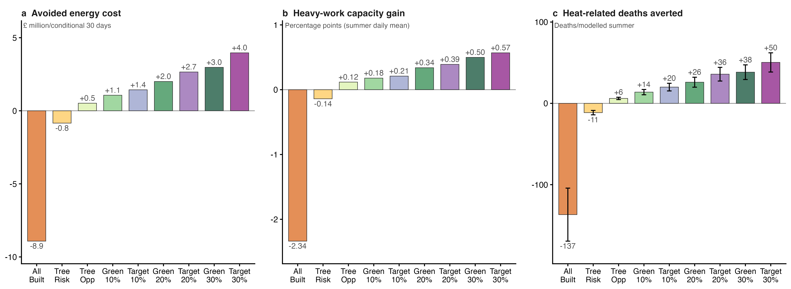
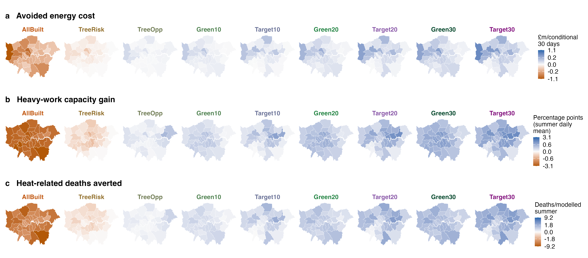
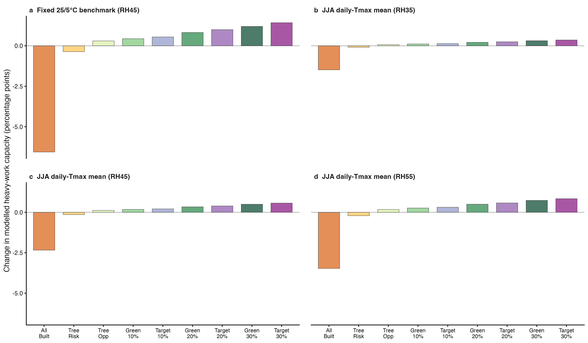
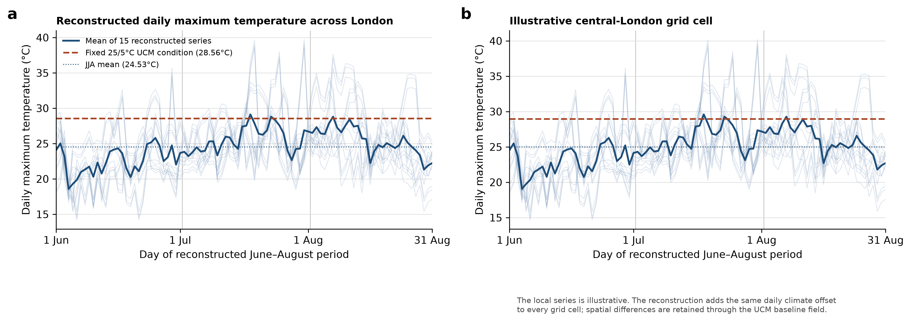

# Corrected energy and work-capacity candidates

Execution follows the [three-reviewer consensus](energy_capacity_consensus.md). These are local candidate analyses, not automatic adoption of new manuscript results. Existing production outputs and Word documents remain unchanged; no push. [Copy-friendly HTML](energy_capacity_candidate_results.html).

## Reporting framework

**Period-selection decision:** the [July versus summer diagnostic and reviewer debate](monthly_outcome_alignment.md), followed by an independent AI cross-check, supports JJA daily-Tmax capacity as the preferred manuscript candidate. The fixed 25/5°C calculation is retained as a benchmark. This is a change of estimand, not a correction that proves the earlier estimate was biased.

| Outcome | Main candidate | Separate sensitivity | Do not interpret as |
|---|---|---|---|
| Energy | London-scaled pooled building allocation, corrected temperature contrast, conditional 30-day kWh and £ | Sector allocation; half versus full assumed cooling transfer | Locally calibrated or forecast summer electricity savings |
| Heavy-work capacity | JJA mean daily-Tmax-based Hothaps capacity at RH45; London area-weighted percentage-point change | Fixed 25/5°C benchmark and JJA RH35/RH55 sensitivities | Average working-day capacity, worker-hours or measured productivity |
| Health | Existing corrected seasonal-health results, WorldClim-aligned SSP370 2041–2060, June–August | Previously documented health sensitivities | Future observed mortality forecast |

Different outcome units and exposure interpretations must remain explicit. The panels compare land-use interventions; they are not three interchangeable summer totals. The capacity mask and building-energy support need not equal the health mask, but each outcome must use matched baseline/scenario support and report its coverage.

Energy holds the transferred demand response, building allocation and tariffs fixed; it does not project future air-conditioning uptake or electricity prices. The full/half cooling-transfer cases are assumptions about applying the spatial cooling contrast, not empirically estimated uncertainty bounds.

## Execution status

All four stages are complete (13 November 2026): independently reviewed pilots, reporting-framework agreement, all-nine calculations, and new PNG figures. The existing seasonal-health outputs were joined without recalculation. The JJA-capacity implementation is explicit and selectable; the fixed-condition adapter remains the default for backward compatibility. Earlier figures and production outputs remain unchanged. Author review and adoption are still pending.

### New figures and all-nine comparison

| Scenario | Conditional energy savings (£m/30 days) | JJA daily-Tmax capacity change (percentage points; RH45) | All-cause deaths averted/modelled summer |
|---|---:|---:|---:|
| AllBuilt | −8.920 | −2.337 | −136.85 |
| TreeRisk | −0.845 | −0.140 | −11.41 |
| TreeOpp | 0.519 | 0.117 | 6.08 |
| Green10 | 1.064 | 0.179 | 13.83 |
| Target10 | 1.435 | 0.210 | 20.01 |
| Green20 | 2.004 | 0.339 | 26.03 |
| Target20 | 2.654 | 0.391 | 35.90 |
| Green30 | 2.972 | 0.499 | 38.37 |
| Target30 | 3.966 | 0.569 | 50.40 |

Target exceeds Green at each matched canopy level for the three main outcomes. The matched-budget ranking also persists across all tested energy allocations/transfers and capacity exposure/humidity settings. This robustness is conditional on the tested assumptions, not empirical validation. Cross-budget rankings need care: corrected sector energy gives Green30 £2.886765m versus Target20 £2.877743m, a small £9,023 difference; the earlier uncorrected sector reversal is not the current result.

All-nine QA passed: 80 city energy records reconcile to 2,640 borough records (maximum residual below 0.000001); 50 capacity records reconcile to 1,650 borough records (maximum residual 3.02 × 10⁻¹⁴ percentage points). Building and pixel support match across scenarios within each outcome; baseline changes are zero; warming losses remain signed. Input hashes are unchanged. The adapter additionally checks identical borough sets and absolute-minus-baseline equality. Plot tests and rendered PNG inspection passed.

### Independent AI cross-check: retained conclusions and corrections

The external review supported outcome-specific periods and JJA daily-Tmax capacity as the more coherent main candidate, but four details were corrected against the saved data and code:

- July is the closest single month for capacity in **12 of 15** climate–weather members, not 10 of 15; August is closest in the other three. Health is split 8 of 15 for July and 7 of 15 for August.
- Capacity and health share the climate ensemble and corrected UCM temperature-contrast family, but not identical exposure arrays. Capacity uses the current-day `offset_c` field on 15,733,893 cells; health uses `lag01_offset_c` on 14,258,588 cells.
- On the exact capacity support, the fixed-condition baseline is 4.035°C warmer on average than the daily JJA reconstruction (28.561 versus 24.525°C), and its capacity changes are about 2.4–2.5 times larger for Green30 and Target30. This is a comparison of different estimands, not proof that one estimate is biased solely by the temperature difference; daily distribution and nonlinear evaluation also differ.
- RH35, RH45 and RH55 are separate sensitivity scenarios, not endpoints of an uncertainty interval. They must not be reported as a range or confidence interval.

### Temperature context for the JJA capacity estimate

Panel a is the **area-weighted London mean** across the same 15,733,893 valid cells used for the Figure 4b JJA capacity calculation. It therefore is the relevant exposure series for interpreting the reported citywide result. Thin lines are the 15 GCM–weather-year reconstructions; the heavy line is their day-specific mean. The fixed 25/5°C UCM condition is represented by its matched London-area mean (28.561°C), rather than by a 92-day time series. The reconstructed JJA mean is 24.525°C.

Panel b adds one illustrative local trajectory: the nearest valid 10-m grid cell to Charing Cross (530,025 m E, 180,375 m N, British National Grid). Its reconstructed JJA mean is 24.998°C, compared with 28.965°C under the fixed 25/5°C UCM condition. It is **not** used to calculate Figure 4b. The WorldClim-aligned reconstruction retains the UCM spatial baseline field, then adds the same member/day climate offset to every grid cell; hence this local curve shows how an urban-centre location differs in level, while its day-to-day variation is parallel to the citywide curve.

The diagnostic is reproducible with [`plot_jja_capacity_temperature_context.py`](../../code/post_processing_layers/plot_jja_capacity_temperature_context.py). Its CSV and manifest sit beside the PNG in the versioned `jja_daily_tmax_context_20261113_v01` diagnostic folder. It does not modify the capacity or health outputs.

### Proposed Results

The final independent PI-role check reconciled all 27 Figure 4 values against Figure 5 (energy and health summed; capacity area-weighted). Maximum differences were 5.60 × 10⁻¹⁴ £ million, 1.10 × 10⁻¹² percentage points and 3.27 × 10⁻¹³ deaths. The borough ranges below and matched-scenario sensitivity rankings were independently verified.

Across the six canopy-expansion scenarios, conditional electricity savings ranged from £1.06 million to £3.97 million per 30-day warm period, while mean modelled heavy-work capacity over June–August increased by 0.18–0.57 percentage points (Fig. 4). Estimated all-cause deaths averted ranged from 13.8 to 50.4 per modelled summer. Target scenarios delivered larger citywide benefits than their matched Green scenarios for all three outcomes. By contrast, AllBuilt and TreeRisk produced adverse changes.

Borough-level benefits varied across outcomes (Fig. 5). Under Target30, conditional electricity savings ranged from £0.013 million to £0.510 million per borough, capacity gains from 0.13 to 1.37 percentage points, and deaths averted from 0.03 to 3.09 per modelled summer. All boroughs benefited under both Green30 and Target30, but larger London totals do not imply larger benefits in every borough.

### Review before adoption

Confirm the explicit conditional-energy framing and the JJA daily-Tmax capacity interpretation; neither is a validated forecast of observed electricity use or working-day productivity. Review Figure 4 v5 and Figure 5 v6, with the fixed 25/5°C result retained as a supplementary benchmark. Once approved, transfer the proposed text to Word and reconcile Abstract, Table 2 and other numerical claims with the adopted results. No additional model runs are required to review this candidate package.

### Step 1: corrected-temperature energy pilot

| Conditional 30-day estimate | Green30 | Target30 |
|---|---:|---:|
| Pooled full-transfer candidate (£ million) | 2.972 | 3.966 |
| Pooled full-transfer candidate (GWh) | 10.786 | 14.456 |
| Temperature correction alone, same coefficients/support (£ million) | +0.0486 | +0.0579 |
| Sector-allocation sensitivity (£ million) | 2.887 | 4.189 |

Half-transfer changes are exactly half their full-transfer counterparts; they are assumed sensitivities, not confidence limits. The correction to temperature is much smaller than the earlier coefficient/allocation correction. The first pilot retains the Target30 advantage under both allocation variants.

The native polygon-based extraction reproduced the legacy baseline building temperatures with **0°C maximum difference**. Of 2,223,411 buildings overlapping London, 2,223,405 have valid paired temperatures. Six buildings (167.718 m² footprint) are excluded identically; 330 buildings have partial NoData coverage identically across the three corrected rasters. Their combined **whole footprint** is 52,936.576 m², not the area of missing pixels. Shared valid raster support was checked, so partial coverage does not silently differ between scenarios. Borough energy allocations reconcile citywide values within 0.000001 in reported aggregate units. Input hashes are unchanged.

### Step 2: work-capacity pilot

All values are changes in **percentage points**, not percent relative changes or working hours.

| Capacity calculation | Green30 | Target30 |
|---|---:|---:|
| Legacy fixed-condition replay on matched support, RH45 | 1.1913 | 1.4193 |
| Corrected fixed-condition candidate, RH45 | **1.1986** | **1.4276** |
| Summer mean of daily-Tmax-based capacity, assumed RH35 | 0.3139 | 0.3594 |
| Summer mean of daily-Tmax-based capacity, assumed RH45 | 0.4990 | 0.5691 |
| Summer mean of daily-Tmax-based capacity, assumed RH55 | 0.7363 | 0.8408 |

Corrected temperature inputs change the fixed-condition estimates only slightly. The daily reconstruction gives materially different magnitudes, reflecting a different distribution of exposure as well as evaluation of a nonlinear response before averaging. This comparison is **not an isolated estimate of the effect of nonlinearity**, nor evidence that either calculation represents observed working-day capacity. Target30 exceeds Green30 in each tested setting; the difference's magnitude depends on the assumptions.

The capacity mask contains 15,733,893 valid London cells: 63 fewer than the previous capacity support, and 1,475,305 more than the health support. Each capacity comparison uses the same mask; health offsets retain their original centring rather than being recentered on this larger domain. Lookup error against direct daily calculations is at most 1.09 × 10⁻⁹ in capacity fraction; borough-to-city reconciliation is below 4 × 10⁻¹⁵ percentage points. Bounds, baseline-zero, local cooling/warming sign and source-preservation checks passed. A separate replay against saved legacy capacity on the new matched support differs by less than 2 × 10⁻⁹ percentage points for the Green30/Target30 mean changes.

## Proposed manuscript text

### Methods: energy, work capacity and aggregation

We estimated conditional electricity savings by scaling the national warm-weather demand response to London's share of Great Britain electricity consumption in 2021 (0.1336). We allocated 99% of this sensitivity to eligible non-residential building footprints and 1% to residential footprints; these allocation assumptions were tested separately. Building-level savings were calculated from paired baseline–scenario temperatures, footprint area, the allocated coefficient and fixed input tariffs. Values represent a conditional 30-day warm period, not observed or forecast seasonal consumption. Borough allocations conserve the unique-building London total. Modelled heavy-work capacity was calculated by applying the continuous Hothaps response to simplified WBGT for each reconstructed daily maximum temperature at 45% relative humidity, before averaging equally over 92 June–August days and 15 climate–weather members. Capacity changes were weighted by grid-cell area within London and each borough. The capacity calculation uses current-day temperature offsets; the health analysis separately uses 0–1-day lagged exposure and a smaller common health mask. Supplementary analyses evaluated a fixed 25/5°C benchmark, alternative humidity assumptions, and energy-allocation and cooling-transfer assumptions. These sensitivities do not represent total uncertainty intervals.

The primary energy candidate assumes full transfer of the modelled cooling contrast to the demand-response exposure; half transfer is a sensitivity. This transfer is not an empirical validation of the correspondence between model temperature and the source study's daily-mean exposure metric.

### Figure 4 legend

**Fig. 4 | Modelled co-benefits of alternative land-use scenarios across London.** Changes relative to baseline land use are shown for (a) conditional avoided electricity costs over a 30-day warm period, (b) mean modelled heavy-work capacity over June–August and (c) all-cause deaths averted per modelled summer. Energy uses a London-scaled demand-response proxy allocated across buildings. Capacity is calculated from reconstructed daily maximum temperatures at 45% relative humidity and averaged by area over 92 days and 15 climate–weather members. Health uses reconstructed daily summer temperatures under SSP370 in 2041–2060, with fixed 2021 population and mortality. Negative values indicate adverse changes. Health whiskers show sensitivity to the reported lower and upper exposure–response coefficients, not total model uncertainty; energy and capacity do not include uncertainty intervals. Scenario definitions are provided in Table 1.

### Figure 5 legend

**Fig. 5 | Borough-level distribution of modelled land-use co-benefits.** Maps show scenario-minus-baseline changes in (a) conditional electricity costs avoided per 30-day warm period, (b) mean modelled heavy-work capacity over June–August and (c) deaths averted per modelled summer. Energy totals are allocated among boroughs without double-counting buildings; capacity is area-weighted within each borough; health values are borough totals. Each outcome uses a common symmetric, zero-centred colour scale across scenarios, with a pseudo-log transformation to retain smaller changes alongside extreme values. Colours indicate spatial variation, not statistical significance. Model assumptions and outcome-specific reporting periods follow Fig. 4.

### Capacity sensitivity legend

**Supplementary figure | Sensitivity of modelled heavy-work capacity to exposure and humidity assumptions.** Bars compare a fixed 25/5°C benchmark at 45% relative humidity with June–August means calculated from daily maximum temperatures at assumed relative humidities of 35%, 45% and 55%. For the daily-temperature panels, capacity is calculated before averaging equally over 92 days, three climate models and five historical weather patterns. Changes are area-weighted London means relative to matched baseline land use. Humidity settings are separate sensitivity scenarios, not confidence limits. The estimates do not represent average capacity across working hours.

## Reproducibility

Outputs are separate diagnostic candidates, not new production aliases:

- [Energy all-nine tables and manifest](</Users/yingjiel/Library/CloudStorage/GoogleDrive-yingjiel@stanford.edu/Shared drives/Wellcome Trust Project Data/2_postprocess_intermediate/UCM_official_runs/diagnostics/energy_corrected_20261112_v01/allnine>): four allocation variants × two transfer settings, with the original three-scenario pilot preserved.
- [Capacity all-nine tables, rasters and manifest](</Users/yingjiel/Library/CloudStorage/GoogleDrive-yingjiel@stanford.edu/Shared drives/Wellcome Trust Project Data/2_postprocess_intermediate/UCM_official_runs/diagnostics/capacity_corrected_20261112_v02_allnine>): corrected/legacy fixed-condition comparisons and three daily-Tmax humidity sensitivities.
- [Preferred JJA-capacity summary, PNGs, plot data and manifests](</Users/yingjiel/Library/CloudStorage/GoogleDrive-yingjiel@stanford.edu/Shared drives/Wellcome Trust Project Data/2_postprocess_intermediate/UCM_official_runs/diagnostics/cobenefits_candidate_20261113_v02_jja_capacity/summary>): Figure 4 v5, Figure 5 v6 and capacity sensitivity v2. Figure 4 v4 and Figure 5 v5 are retained in the same folder as the immediately preceding label versions.
- [Preserved fixed-condition candidate](</Users/yingjiel/Library/CloudStorage/GoogleDrive-yingjiel@stanford.edu/Shared drives/Wellcome Trust Project Data/2_postprocess_intermediate/UCM_official_runs/diagnostics/cobenefits_candidate_20261113_v01/summary>): Figure 4 v3, Figure 5 v4 and capacity sensitivity v1. These PNG/CSV files are kept together; no PDF/SVG copies.

The run-family names retain 20261112; the final figures use their completion date, 20261113. Only output names are versioned, not scripts. The energy/capacity manifests record input hashes and the figure manifests record plot sources. Use the command-line help for both runners; the summary adapter requires `--energy`, `--capacity`, a fresh `--output` directory and an explicit `--capacity-method` when selecting `daily_tmax_sensitivity`. Both main plot scripts use `--seasonal-health-root` pointing to `seasonal_health_all_scenarios_2026-11-12_v1`, plus a new `--figure-version`. The capacity sensitivity plot takes the capacity city CSV and a new PNG path. Do not reuse a completed candidate output directory/version.

- [Corrected energy runner](../../code/post_processing_layers/run_corrected_energy_candidate.py): polygon-based building temperatures, allocation and paired energy accounting.
- [Corrected capacity runner](../../code/post_processing_layers/run_corrected_capacity_candidate.py): fixed-condition and daily-Tmax capacity, shared spatial support and numerical checks.
- [Summary adapter](../../code/post_processing_layers/prepare_candidate_valuation_summary.py): joins verified all-nine outputs for the existing plotting scripts without installing them as production.
- [Figure 4 script](../../code/post_processing_layers/plot_figure4_citywide.R) and [Figure 5 script](../../code/post_processing_layers/plot_figure5_borough_cobenefits.R): retain earlier workflow and add seasonal-health/versioned candidate options.
- [Capacity sensitivity plot](../../code/post_processing_layers/plot_capacity_candidate_sensitivity.R): separate supplementary PNG, same scenario palette and 0.7 bar transparency.

The [energy correction explanation](energy_scaling_correction_test.md) remains authoritative for the coefficient rationale and worked examples; it is not duplicated here. The [seasonal-health report](seasonal_health_rerun_comparison.md) remains authoritative for health assumptions and results.
