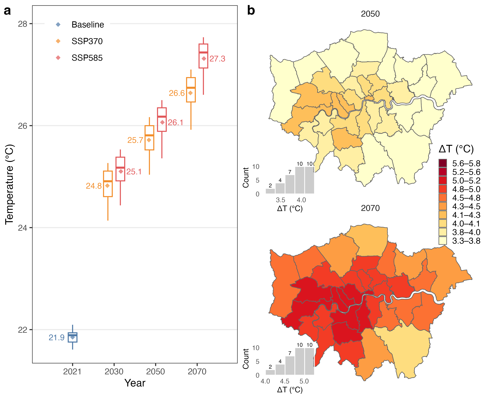
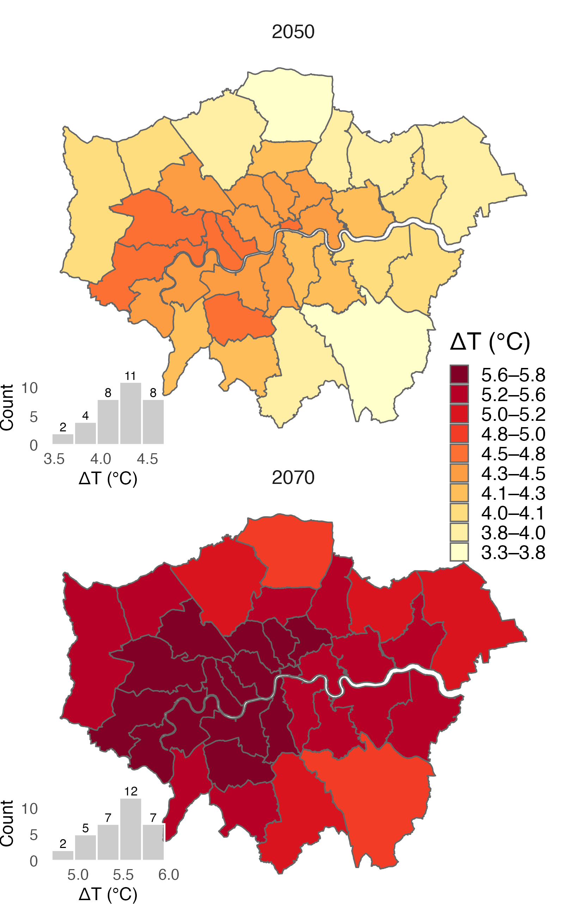
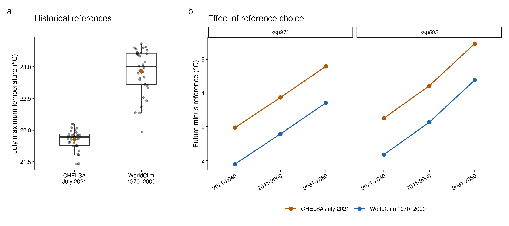
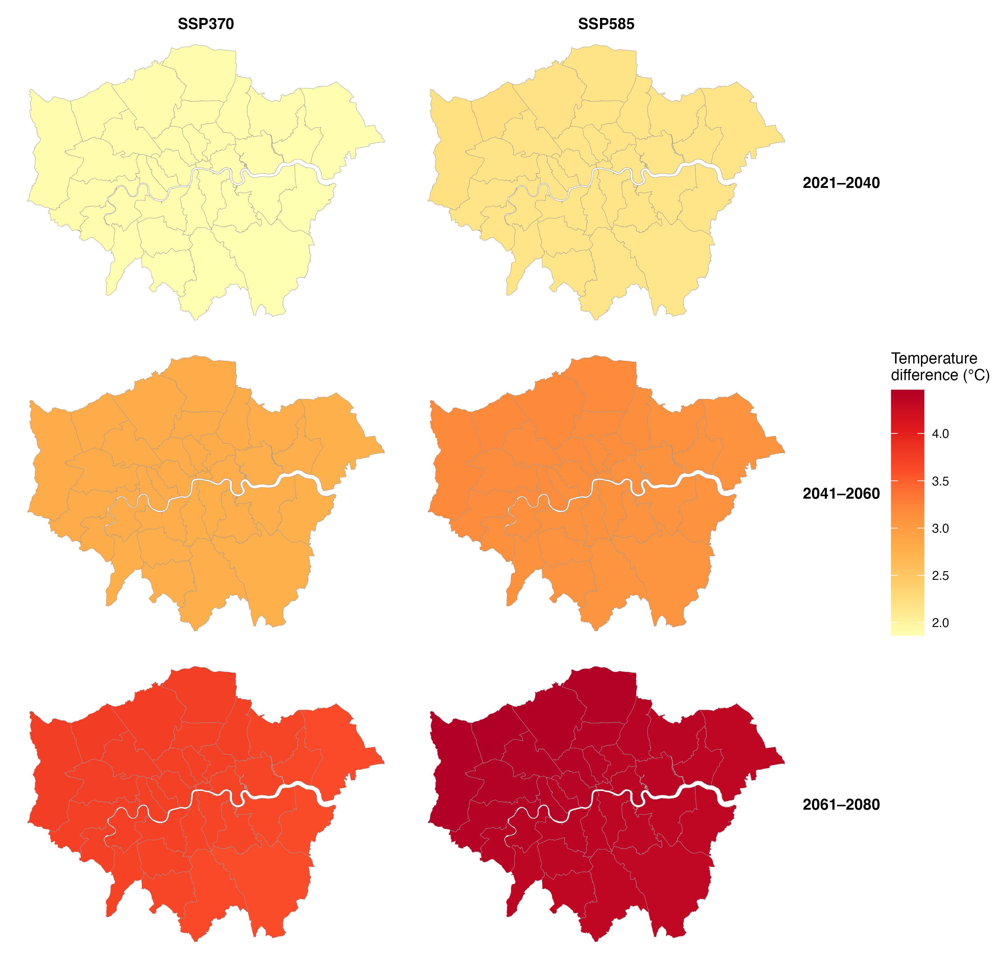

# Figure 1: historical-reference comparison

11 November 2026 · [Copy-friendly HTML](figure1_historical_reference_comparison.html)

## Decision and status

**Current author selection: main Figure 1 v03 and SSP585 v02, automatic histogram bins.**
The fixed-bin trial (main v04 / SSP585 v03) is retained for comparison but
is not selected. The plotting script defaults have been restored accordingly.
CHELSA July 2021
is the only historical boxplot in the main figure. Panel a retains both SSPs;
panel b contains only SSP370 in 2050 and 2070. SSP585 maps are supplementary.
WorldClim historical data remain in the comparison and matched-baseline SM,
not the main boxplot. Earlier two-reference figure v1 is preserved.
Previous figures, Figure 2 and Word remain unchanged; nothing has been pushed.

## Current main figure and legend

**Fig. 1 | Baseline and projected July temperatures across London. a,**
Distributions of July mean daily maximum temperature across 33 boroughs,
using CHELSA for July 2021 and WorldClim for future periods under SSP370 and
SSP585. Future values are averaged across three climate models (Methods);
2030, 2050 and 2070 denote 2021–2040, 2041–2060 and 2061–2080, respectively.
Boxes show medians and interquartile ranges; whiskers extend to observations
within 1.5 interquartile ranges. Outliers are not shown. Diamonds and labels
indicate unweighted borough means. **b,** SSP370 temperature differences
relative to CHELSA July 2021. Colours represent deciles pooled across the two
displayed periods and both SSPs. Insets show borough counts in five bins,
with bin boundaries and axes determined separately for each inset.
Differences include product and reference-period effects and should not be
interpreted solely as warming since 2021. SSP585 maps and comparisons using
a matching WorldClim historical baseline are provided in the Supplementary
Information.

### Proposed Results

Mean July daily maximum temperature across London's 33 boroughs was 21.9°C
in the CHELSA July 2021 reference. WorldClim projections reached 25.7°C under
SSP370 and 26.1°C under SSP585 in 2041–2060, rising to 26.6°C and 27.3°C,
respectively, in 2061–2080 (Fig. 1a). Differences from the 2021 reference
were therefore 3.9–4.2°C at mid-century and 4.8–5.5°C later in the century.
Under SSP370, borough-level differences ranged from 3.3–4.2°C and 4.1–5.1°C
in the two periods, respectively (Fig. 1b). These cross-product comparisons
include reference-period and product effects; comparisons using a matching
WorldClim historical baseline are presented in the Supplementary Information.

### SSP585 supplementary maps

**Supplementary figure | SSP585 July temperature contrasts.** Borough-mean
future WorldClim minus CHELSA July 2021 for 2041–2060 (2050) and 2061–2080
(2070), averaged across the same three GCMs. Colours use the identical pooled
decile thresholds as main Fig. 1b. Insets use five automatically determined
bins per period; labels indicate counts across 33 boroughs. Bin boundaries
and axes vary between insets. These are cross-product contrasts, not
harmonized warming since 2021.

### Current production and verification

The updated [entry notebook](../../code/gcm-data-clip-stats-viz.Rmd) calls
`build_figure1(comparison_dir, boundary, output_dir)` in
[plot_figure1.R](../../code/post_processing_layers/plot_figure1.R), using
`URBAN_COOLING_DATA_ROOT`. The borough production path exits before archived
plotting code; the LSOA cache workflow is unchanged. The helper uses the
validated comparison CSVs and borough boundary documented below.

Outputs are versioned 450-dpi white-background PNGs. All earlier files remain.
The new SSP585 map is shown above; the separate matched-WorldClim SM remains
`figure1_sm_worldclim_v02_20261111.png`.
The source/output checksum manifest shares the main PNG stem. Checks require
594 unique source records and 198 ensemble borough/SSP/period values, and
reproduce table means within 1e-8°C. Main and SSP585 maps explicitly filter
one SSP before plotting, avoiding the older period-only overlay. Original
blue/orange/red boxplot colours, one-decimal mean labels, theme_bw, YlOrRd
quantile map palette, grey borough outlines and histogram insets are restored.
Main layout is a left boxplot and right vertically stacked maps (7.2 × 5.7 in).
The matched-WorldClim SM retains its own continuous scale; do not equate its
colours with the main/SSP585 discrete legend. HTML embeds are capped at
680 pixels wide and 760 pixels tall; PNG resolution is unchanged.

Review the new figures and legends and assign SM numbering before Word insertion.
The comparison and earlier proposals below are retained as provenance.

### Inset check and version comparison

Each histogram is built from 33 unique boroughs after averaging the three
GCMs within that SSP/period. The selected version retains the original
automatic five-bin method. Compare the labelled temperatures and counts,
not bar positions across insets: bin edges and axis ranges are not shared.
The unselected fixed-bin trial remains available in the version table below.
Bin edges/counts are exported in the current main manifest
and independently recounted using `cut()`; each histogram sums to 33.

| SSP | Period | Five automatic-bin counts, left to right |
|---|---|---|
| SSP370 | 2050 | 2, 4, 7, 10, 10 |
| SSP370 | 2070 | 2, 4, 7, 10, 10 |
| SSP585 | 2050 | 2, 4, 8, 11, 8 |
| SSP585 | 2070 | 2, 5, 7, 12, 7 |

In selected v03, identical SSP370 automatic-bin counts are genuine: its 2050
range is 3.252–4.194°C and 2070 range is 4.128–5.137°C, with different
histogram edges. Insets use `grey60`, white bar borders and alpha 0.5 as in
the original script. Both panel and plot backgrounds are transparent;
the earlier opaque white rectangle was an unintended styling change.

V3 adapts the original pooled deciles to 132 displayed borough/period/SSP
values, rather than including the omitted 2030 maps. This allocates more
classes to the displayed range while retaining the same thresholds across
all four maps. Exact thresholds are stored in the manifest; legend rounding
does not change classification. There are no scenario-specific quantiles.

Files now sort by figure family, then zero-padded version, then date:

| Family | Versions available | Current |
|---|---|---|
| `figure1_main_v##_20261111.png` | v01: two references; v02: opaque insets; v03: transparent automatic-bin insets; v04: unselected fixed-bin trial | v03 |
| `figure1_sm_ssp585_v##_20261111.png` | v01: opaque insets; v02: transparent automatic-bin insets; v03: unselected fixed-bin trial | v02 |
| `figure1_sm_worldclim_v##_20261111.png` | v01, v02 retained | v02 |

These names replace the earlier descriptive filenames without deleting their
image content. Scripts, documentation and manifest paths were updated. Select
adjacent versions in Finder and use Quick Look to switch between them. The
main v01 has a different aspect ratio because its layout was intentionally
different; v02/v03 have identical dimensions for direct comparison.

## Verified results

All values are equal-weight means of 33 borough means; future values also
give equal weight to ACCESS-CM2, IPSL-CM6A-LR and MRI-ESM2-0.

- CHELSA July 2021: **21.8505°C**.
- WorldClim July 1970–2000: **22.9318°C**.
- Historical-reference difference: **1.0813°C**. This is a product/period
  contrast, not evidence that London cooled by this amount.

| Future period | SSP | Future temperature (°C) | Minus CHELSA 2021 (°C), main | Minus historical WorldClim (°C), supplement |
|---|---|---:|---:|---:|
| 2021–2040 | SSP370 | 24.82 | 2.97 | 1.89 |
| 2021–2040 | SSP585 | 25.10 | 3.25 | 2.17 |
| 2041–2060 | SSP370 | 25.72 | 3.87 | 2.79 |
| 2041–2060 | SSP585 | 26.06 | 4.21 | 3.13 |
| 2061–2080 | SSP370 | 26.64 | 4.79 | 3.71 |
| 2061–2080 | SSP585 | 27.31 | 5.46 | 4.38 |

**Interpretation:** the period and SSP ordering is unchanged. Main-reference
differences exceed matched-WorldClim differences by 1.0813°C in these means.
The offset varies from **0.45 to 1.41°C across boroughs**, so mapped spatial
contrasts need not be identical; this is not merely a uniform shift of every map.
Neither comparison supplies a probabilistic uncertainty interval.

Points in panel a are boroughs; diamonds show equal-borough means, boxes show
medians and interquartile ranges, whiskers extend to values within 1.5 IQR.
Panel b compares the two subtraction choices without altering future inputs.

## Supplementary map for review

**Proposed legend.** Projected differences in July mean daily maximum
temperature relative to WorldClim v2.1's 1970–2000 climatology. Maps show
borough means for two SSPs and three future periods, averaged across
ACCESS-CM2, IPSL-CM6A-LR and MRI-ESM2-0. Historical and future data use the
WorldClim 30-arc-second products and the same borough cell-centre inclusion
rule. Colours use a common scale. This sensitivity complements, rather than
replaces, the main comparison with CHELSA July 2021.

## Data and reproducibility

Official [WorldClim historical documentation](https://www.worldclim.org/data/worldclim21.html)
defines the baseline as 1970–2000 and temperature units as °C. The selected
entry is `wc2.1_30s_tmax_07.tif` in the official
[30-arc-second monthly Tmax archive](https://geodata.ucdavis.edu/climate/worldclim/2_1/base/wc2.1_30s_tmax.zip).
Only July was downloaded (about 373 MB compressed), not the full 4.38 GB ZIP.
The downloader checks the archive entry CRC and records the source URL,
ETag and file SHA256. No source climate values were modified.

Paths relative to the external **Wellcome Trust Project Data** root:

- Raw and download manifest: `1_preprocess/UrbanCoolingModel/OfficialWorkingInputs/climate/worldclim_v21_historical/`.
- Derived London raster, borough/model CSVs and checksum manifest: its `comparison/` subfolder.
- Comparison filenames begin `figure1_baseline_comparison_20261111_v1`.
- PNG review outputs are in repository `figures/climate_projections/`.

| Script | Purpose |
|---|---|
| [fetch_worldclim_july.py](../../code/post_processing_layers/fetch_worldclim_july.py) | Selectively download the July raster with source checks |
| [compare_figure1_baselines.py](../../code/post_processing_layers/compare_figure1_baselines.py) | Validate saved future summaries and calculate both differences |
| [plot_figure1_baseline_comparison.R](../../code/post_processing_layers/plot_figure1_baseline_comparison.R) | Exploratory comparison and archived SM v1 |
| [plot_figure1.R](../../code/post_processing_layers/plot_figure1.R) | Current main Figure 1 and SM v2 |
| [gcm-data-clip-stats-viz.Rmd](../../code/gcm-data-clip-stats-viz.Rmd) | Current main/SM entry point using plot_figure1.R; earlier code retained |

Run the Python comparison with repository path, external data-root path and
`--output-dir` pointing to `comparison/`. Run the R plotter with three arguments:
comparison directory, `AOIs/London_Borough_aoi.shp`, and the PNG output directory.
Use the project's InVEST 3.20.2 Python environment (GDAL/NumPy); the R plotter
uses ggplot2, sf and patchwork. The downloader takes the destination directory
as its single positional argument and refuses to overwrite an existing raster.

**Boundary-method verification:** all 18 saved future raster/CSV pairs were
checked (594 borough/model/period/SSP records). Their pixel counts match
centre inclusion exactly and means agree within 0.0001°C. The current Python
notebook says `all_touched=True`, but this does not reproduce those saved
counts. The new historical summary therefore uses centres to match the
actual Figure 1 inputs, not the conflicting notebook setting. No saved
future CSV was overwritten. Native grids were retained without resampling.
