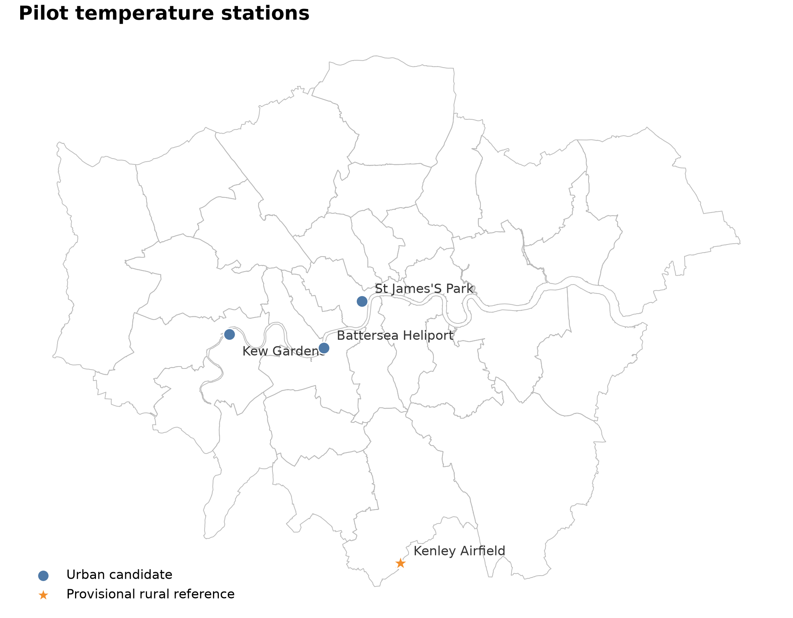
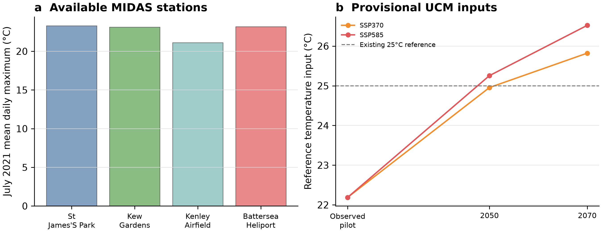
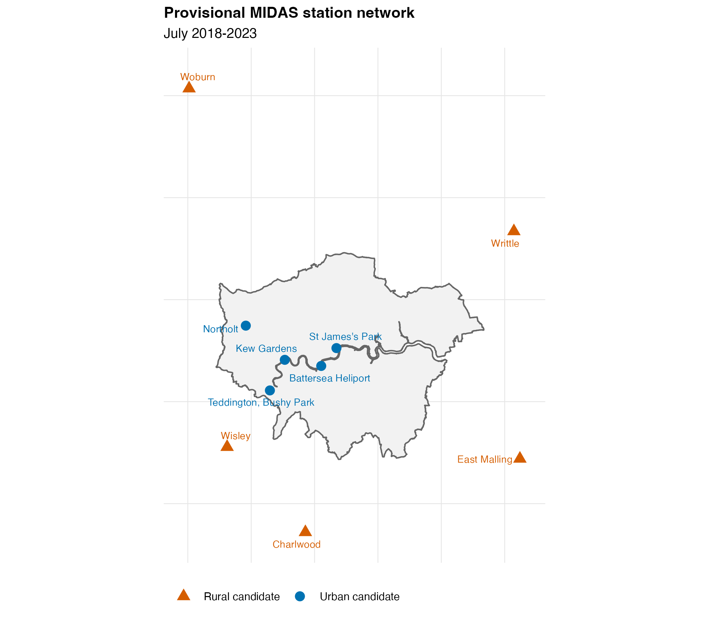
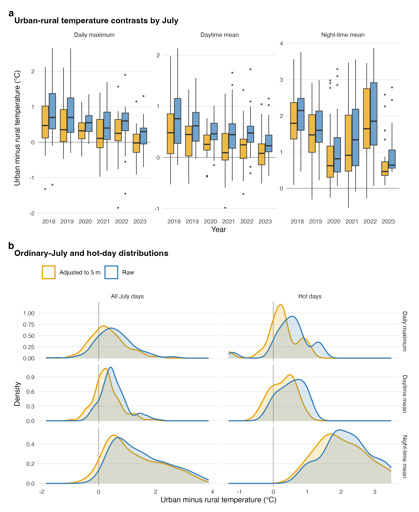
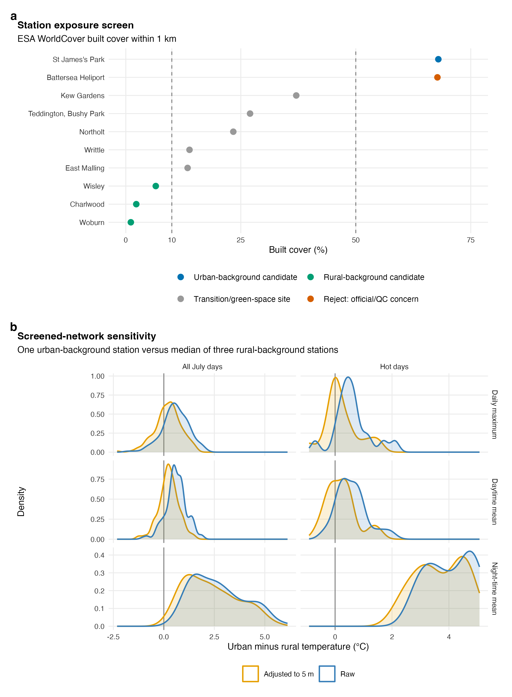
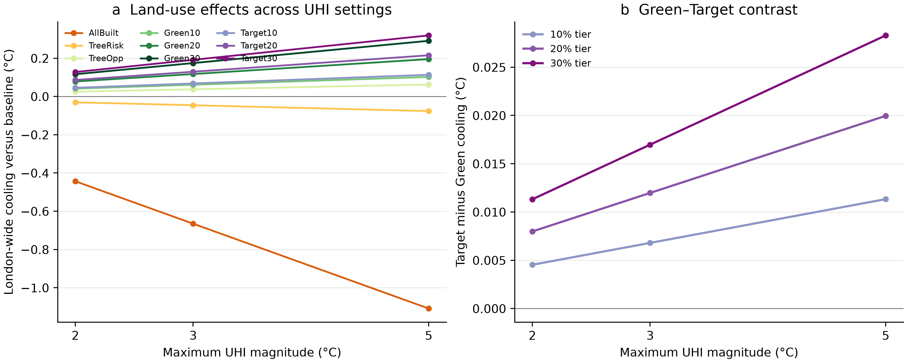
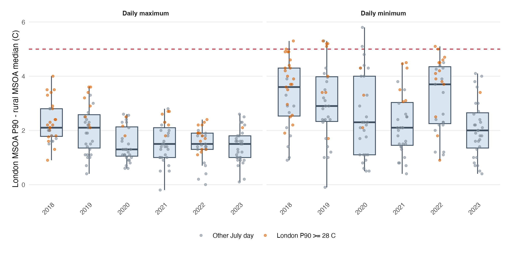
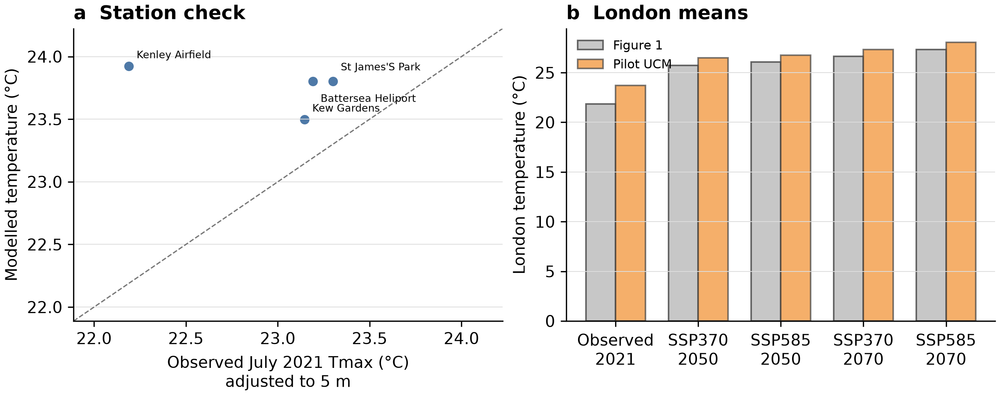

# Pilot preparation of InVEST climate parameters

11 November 2026 · v5 diagnostic pilot · [Copy-friendly HTML](ucm_climate_parameter_pilot.html)

## Retained manuscript configuration

**Author decision, 11 November 2026: retain `T_ref = 25°C` and
`UHI_max = 5°C` for the prescribed 2050 scenario, and retain 28/5°C for the
prescribed 2070 scenario.** Existing production outputs remain the manuscript basis.
Report this as a prescribed warm-condition stress-test, not an observationally
calibrated 2050 or 2070 daily-maximum climate estimate. Retain the temperature-only
2/3/5°C comparison as supporting sensitivity evidence; it establishes ranking
stability within this model, not robustness of downstream health or work-capacity
magnitudes. No further production reruns are required by this decision, and
health/work-capacity sensitivity tests remain on hold. Additional station
calibration is a future improvement, not a prerequisite for this retained
prescribed-condition analysis. Copy-ready Methods and Figure 3 legend/Results
are maintained in the [Figure 3 review document](figure3_climate_uhi_audit.md#proposed-methods-climate-scenarios-and-temperature-summaries), not duplicated here.

### Evidence and qualification

**Retain 25/5°C only as an explicitly prescribed warm stress-test, not as a
calibrated 2050 climate estimate.** The future-temperature pilot supports a
reference temperature close to 25°C in 2050. The expanded 10-station, six-July
pilot does not support 5°C as a representative July daily-maximum air-temperature
contrast. A stricter exposure screen leaves only one urban-background station;
against three rural-background stations, its daily-maximum P90 is 1.38°C, while
the hot-day night-time P90 is 4.97°C. Thus 5°C is defensible only as an upper-tail
nocturnal or prescribed stress-test, not as the representative daily-maximum
contrast paired with July `T_ref`. The screened result is diagnostic rather than
a replacement production parameter. A temperature-only sensitivity at
`T_ref = 25°C` shows that the ranking of the nine land-use scenarios is identical
at `UHI_max = 2, 3 and 5°C`; the parameter mainly scales absolute temperature
effects. Health and work-capacity testing remains on hold. An independent
Crowd-Grid spatial sensitivity reaches the same conclusion:
the robust July daily-maximum contrast never reaches 5°C, whereas the hot-day
daily-minimum P90 is 5.08°C.

## Pilot design

The pilot used the four locally available MIDAS stations with complete July 2021
files: St James's Park, Kew Gardens, Kenley Airfield and Battersea Heliport.
Kenley was the provisional rural station because it is peripheral and its 500-m
surroundings are 70.4% grass and 21.7% urban in LCM2023. It is 170 m above sea
level, so its temperatures were also translated to a common 5-m elevation using
a fixed 0.0065°C m⁻¹ lapse rate. This correction is a sensitivity assumption,
not a substitute for low-elevation rural observations.

For each station, the analysis calculated July daily maxima from numeric hourly
observations, requiring at least 18 observations per day. All 31 days passed at
all four stations; hourly completeness was 99.6–100%. The provisional UHI was
the 90th percentile of the daily difference between the warmest of the three
urban candidates and elevation-adjusted Kenley.



The map shows why the result remains provisional: three stations are clustered
in inner/west London, while the only peripheral candidate is Kenley. It is not a
spatially balanced urban–rural monitoring network.

The future rural reference used the delta method:

`observed Kenley reference + future WorldClim July Tmax − historical WorldClim July Tmax`

at Kenley for ACCESS-CM2, IPSL-CM6A-LR and MRI-ESM2-0. SSP370 and SSP585 were
kept separate for both 2041–2060 (2050) and 2061–2080 (2070). Five
baseline-land-use, temperature-only InVEST 3.20.2 runs were then made: observed
2021 and the two SSPs in 2050 and 2070. No energy, health or work-capacity
component was run.



## Parameter estimates

| Quantity | Pilot estimate |
|---|---:|
| Elevation-adjusted observed rural reference | 22.19°C |
| Raw UHI median / P90 / maximum | 2.50 / 3.20 / 3.60°C |
| Elevation-adjusted UHI median / P90 / maximum | 1.43 / 2.13 / 2.53°C |
| SSP370 2041–2060 ensemble-mean `T_ref` | 24.96°C |
| SSP585 2041–2060 ensemble-mean `T_ref` | 25.26°C |
| SSP370 2061–2080 ensemble-mean `T_ref` | 25.82°C |
| SSP585 2061–2080 ensemble-mean `T_ref` | 26.52°C |

The GCM-specific SSP370 reference temperatures range from 24.49 to 25.49°C;
SSP585 ranges from 24.59 to 25.89°C. Thus the existing 25°C reference is close
to this pilot's mid-century rural-temperature estimate. The existing 5°C UHI,
however, is above every observed July 2021 contrast in this four-station pilot.
This does not establish that 5°C is impossible during other years, hours or heat
events.

For 2070, the GCM-specific reference temperatures span 24.79–26.99°C under
SSP370 and 25.29–27.59°C under SSP585. These ranges represent model spread,
not a confidence interval.

## Expanded six-year station check

The acquisition pilot adds five provisional urban and five provisional rural
stations for July 2018–2023 (60 station-year files). MIDAS version-1 records were
deduplicated by station and observation time, retaining the latest record
timestamp. Primary estimates exclude temperatures whose MIDAS status digit is
`1` (observed but suspect); status `0` denotes observed and not suspect. The
interpretation follows the official [MIDAS quick-start
guide](https://doi.org/10.5281/zenodo.10908145) and [quality-code
table](https://data.ceda.ac.uk/badc/ukmo-midas/metadata/doc/QC_J_flags.html).

Daily extrema require at least 18 distinct hourly records. Daily maximum is the
primary statistic because Figure 1 and `T_ref` use July maximum temperature.
As a supplementary check using the same hourly MIDAS files, daytime means use
09:00–17:00 UTC (approximately 10:00–18:00 British Summer Time) and require at
least seven of nine observations. Night-time means use 22:00–05:00 UTC and
require at least six of eight observations. The daytime window is deliberately
reported as a sensitivity rather than substituted for daily maximum: an average
over daytime hours and the daily maximum are different estimands, but agreement
between them helps show whether the result is driven by one extreme hour. The
urban and rural daily values are medians across available stations, requiring
at least three stations per group. “Hot days” are the 19 dates on or above the
pooled 90th percentile of the rural-network July daily maximum. The fixed
0.0065°C m⁻¹ translation to 5 m is retained only as an elevation sensitivity.





| Period and statistic | Raw median | Raw P90 | Raw maximum | Elevation-adjusted median | Elevation-adjusted P90 | Elevation-adjusted maximum |
|---|---:|---:|---:|---:|---:|---:|
| All July days: daily maximum | 0.50°C | 1.38°C | 2.65°C | 0.25°C | 1.13°C | 2.12°C |
| All July days: daytime mean | 0.46°C | 1.04°C | 2.13°C | 0.26°C | 0.82°C | 1.98°C |
| All July days: night-time mean | 1.38°C | 2.95°C | 3.86°C | 1.16°C | 2.80°C | 3.56°C |
| Hot days: daily maximum | 0.55°C | 1.27°C | 1.40°C | 0.26°C | 0.88°C | 1.08°C |
| Hot days: daytime mean | 0.57°C | 1.00°C | 1.09°C | 0.29°C | 0.67°C | 0.91°C |
| Hot days: night-time mean | 2.09°C | 3.12°C | 3.49°C | 1.83°C | 2.89°C | 3.46°C |

The result depends on the temperature statistic. Daily maximum and daytime mean
give closely similar, modest contrasts; the nocturnal signal is larger and
increases on hot days. This supports retaining daily maximum as the primary
statistic, using daytime mean as corroboration, and treating daytime and
night-time UHI as distinct quantities. Including
suspect records raises the hot-day raw night-time median from 2.09°C to 2.70°C,
but its maximum remains 3.85°C. Leave-one-station-out maxima reach 4.24°C for
night-time means and 2.75°C for daily maxima. None of these checks validates
5°C as the representative July daily-maximum input used in the production run.

### Station-history and exposure screen

The formal screen combines official MIDAS source and station-remark records,
temperature QC, and ESA WorldCover 2021 built cover within 1 km. The diagnostic
thresholds were specified before recalculating UHI: urban background requires
at least 50% built cover; rural background requires at most 10% built cover and
elevation no higher than 100 m. Intermediate sites are classified as
transition/green-space settings. An official all-elements-suspect remark or at
least 50% suspect temperature records overrides land-cover classification.



Only St James’s Park passes as an urban-background candidate (67.9% built cover
within 1 km). Wisley, Charlwood and Woburn pass as rural-background candidates
(6.5%, 2.3% and 1.1% built cover). Kew Gardens, Teddington–Bushy Park, Northolt,
Writtle and East Malling lie between the pre-specified thresholds and are not
used in the screened contrast. Battersea Heliport is rejected: all its numeric
temperatures carry MIDAS status `1`, and the official station remark states that
all elements are suspect because of tall buildings, rotor wash, engine exhaust,
heat sources and a non-standard screen.

| Screened one-urban/three-rural contrast | Raw median | Raw P90 | Raw maximum | Elevation-adjusted median | Elevation-adjusted P90 | Elevation-adjusted maximum |
|---|---:|---:|---:|---:|---:|---:|
| All July days: daily maximum | 0.60°C | 1.38°C | 2.10°C | 0.25°C | 0.99°C | 1.55°C |
| All July days: daytime mean | 0.58°C | 1.30°C | 1.91°C | 0.23°C | 0.87°C | 1.51°C |
| All July days: night-time mean | 2.51°C | 4.73°C | 6.13°C | 2.21°C | 4.38°C | 5.58°C |
| Hot days: daily maximum | 0.50°C | 1.35°C | 2.10°C | 0.09°C | 1.08°C | 1.55°C |
| Hot days: daytime mean | 0.53°C | 1.11°C | 1.91°C | 0.16°C | 0.81°C | 1.51°C |
| Hot days: night-time mean | 4.03°C | 4.97°C | 5.08°C | 3.55°C | 4.62°C | 4.79°C |

This screen sharpens rather than reverses the interpretation. A 5°C contrast is
plausible in the upper tail of hot-night conditions, but it remains unsupported
for the July daily-maximum statistic paired with the current reference
temperature. Because only one urban-background site passes, the screened result
cannot support spatial calibration or held-out validation. Additional
quality-controlled urban air-temperature stations are the limiting requirement.

## Temperature-only UHI sensitivity

To determine whether the uncertain `UHI_max` changes the land-use conclusions,
InVEST 3.20.2 was run at `T_ref = 25°C` with `UHI_max = 2°C` and `3°C` for the
baseline and all nine land-use scenarios. These diagnostic runs used the same
land-cover rasters, biophysical table, evapotranspiration input, grid and model
settings as the existing `UHI_max = 5°C` production run. Only temperature was
calculated; energy, WBGT, health and the modified Hothaps work-capacity component
were not run. The existing 5°C temperature rasters were reused rather than
overwritten.



| Scenario | Cooling at UHI 2°C | Cooling at UHI 3°C | Cooling at UHI 5°C | Rank at all settings |
|---|---:|---:|---:|---:|
| Target30 | 0.128°C | 0.192°C | 0.319°C | 1 |
| Green30 | 0.116°C | 0.175°C | 0.291°C | 2 |
| Target20 | 0.086°C | 0.129°C | 0.215°C | 3 |
| Green20 | 0.078°C | 0.117°C | 0.195°C | 4 |
| Target10 | 0.045°C | 0.068°C | 0.113°C | 5 |
| Green10 | 0.041°C | 0.061°C | 0.102°C | 6 |
| TreeOpp | 0.025°C | 0.037°C | 0.062°C | 7 |
| TreeRisk | −0.031°C | −0.046°C | −0.076°C | 8 |
| AllBuilt | −0.444°C | −0.665°C | −1.109°C | 9 |

Values are London-boundary, equal-cell-area means relative to the matching
baseline; positive values indicate cooling and negative values warming. Scenario
rankings are identical across all three UHI settings (Spearman rank correlation
= 1.00 for every pair). Target produces slightly more London-wide cooling than
Green within each matched canopy tier at every setting. At the 30% tier, the
Target-minus-Green difference scales from 0.011°C at UHI 2°C to 0.017°C at UHI
3°C and 0.028°C at UHI 5°C. The borough direction is also stable: Target30 cools
more than Green30 in 19 boroughs, while Green30 cools more in 14.

This is expected from the InVEST air-temperature equation: for fixed cooling
coefficients, temperature differences scale approximately linearly with
`UHI_max`. The sensitivity therefore supports the **comparative** conclusion
that scenario ranking and the Green–Target contrast are robust to the tested
UHI range. It does not validate 5°C as a representative daytime parameter, and
absolute temperatures and downstream health or work-capacity magnitudes would
change if a different UHI value were adopted.

## Crowd-Grid spatial sensitivity

Crowd-Grid v1.0 was added as a complementary spatial check because the official
MIDAS screen leaves only one eligible urban-background station. This Met Office
prototype combines quality-controlled official, crowdsourced and roadside
observations to estimate daily maximum and minimum air temperature at 1-km
resolution. The Recent Heat Packs average those grids over local-authority and
2021 MSOA boundaries. Crowd-Grid is designed to represent built environments
better than HadUK-Grid, but its uncertainty is larger because many observations
come from non-standard exposures. It is therefore used here as a sensitivity,
not as a new production parameter or a replacement for direct observations.

For each July day in 2018–2023, the robust spatial proxy is the 90th percentile
across London MSOAs minus the median of the three MSOAs containing the screened
rural MIDAS stations: Guildford 001 (Wisley), Crawley 001 (Charlwood) and Central
Bedfordshire 007 (Woburn). The supplied 2021 boundary file, rather than an
assumed district name, resolves these locations. “Hot days” are the 53 dates on
which the London MSOA 90th percentile of daily maximum temperature reached at
least 28°C. Because these are MSOA averages, the contrasts smooth local extremes.



| Crowd-Grid contrast | July days | Median | P90 | Maximum | Days at least 5°C |
|---|---:|---:|---:|---:|---:|
| Daily maximum: London MSOA P90 − rural MSOA median | 186 | 1.60°C | 2.68°C | 4.00°C | 0.0% |
| Daily minimum: London MSOA P90 − rural MSOA median | 186 | 2.50°C | 4.50°C | 5.80°C | 5.9% |
| Hot-day daily maximum: London MSOA P90 − rural MSOA median | 53 | 2.20°C | 3.40°C | 4.00°C | 0.0% |
| Hot-day daily minimum: London MSOA P90 − rural MSOA median | 53 | 4.00°C | 5.08°C | 5.30°C | 15.1% |

The result independently confirms the statistic-specific interpretation. A
5°C contrast is not representative of July daily maximum temperature: even the
robust spatial maximum across 186 days is 4.00°C. It is, however, plausible in
the upper tail of daily minimum temperature during hot conditions. A less robust
maximum-London-MSOA comparison reaches 5.80°C by day and 6.60°C by night, but it
is too sensitive to a single MSOA to define a production parameter. Crowd-Grid
therefore strengthens the stress-test framing; it does not remove the need for
additional well-exposed urban stations and held-out validation.

Source and interpretation follow the [Crowd-Grid catalogue
record](https://catalogue.ceda.ac.uk/uuid/1ee84eb83cf8406e8ec86f914aaf172d/)
and [official README](https://doi.org/10.5281/zenodo.17787357). The product is
licensed under the Open Government Licence v3.0 and must be cited using the
catalogue citation.

## Baseline model check



Against the four elevation-adjusted station means, the observed-period baseline
run has bias = MAE = **0.80°C**, RMSE = **0.97°C**, and correlation = **−0.54**.
The correlation is descriptive only (`n = 4`). Kenley is the coolest observed
station but is the warmest modelled station among the four. An unconstrained
two-parameter fit therefore returns a physically impossible negative UHI
(−3.25°C). This is evidence that the available network and/or current model
spatial coefficients cannot calibrate a defensible UHI—not evidence of a real
negative London UHI.

| Configuration | Figure 1 mean (°C) | Pilot UCM London mean (°C) | Difference (°C) |
|---|---:|---:|---:|
| Observed 2021 | 21.85 | 23.70 | +1.85 |
| SSP370 2041–2060 | 25.72 | 26.47 | +0.75 |
| SSP585 2041–2060 | 26.06 | 26.77 | +0.71 |
| SSP370 2061–2080 | 26.64 | 27.34 | +0.70 |
| SSP585 2061–2080 | 27.31 | 28.04 | +0.72 |

These are not like-for-like validation statistics: Figure 1 is an equal-borough
summary of gridded climate products, whereas the UCM value is an area-weighted
mean that explicitly adds local urban heat. They are retained as a consistency
check, not calibrated targets.

## Data-quality findings

| Finding | Evidence and consequence | Severity |
|---|---|---|
| Urban network is inadequate | After official-history, QC and land-cover screening, only St James’s Park remains an urban-background candidate. This is insufficient for spatial calibration or held-out validation. | High |
| Spatial validation fails | Negative four-station correlation and physically impossible fitted UHI. Do not use the pilot parameters as production estimates. | High |
| Temporal evidence is still limited | Six Julys improve on the original single-year pilot, but do not establish long-term return levels or future UHI sensitivity. | Medium |
| Crowd-Grid is a prototype spatial sensitivity | The 1-km product improves built-environment coverage, but includes non-standard exposures and the Heat Packs spatially average grid cells over MSOAs. Use it to test the 5°C framing, not as a calibrated `UHI_max`. | Medium |
| QC invalidates Battersea | Code `106` marks observed-but-suspect data, and the official remark independently identifies site heat/exhaust/rotor effects. Battersea is excluded; some Kew records are also excluded. | High |
| Future anomaly has limited spatial support | It is sampled at Kenley only, although three GCMs and matched historical/future WorldClim data are used. | Medium |

## Approaches for estimating London UHI

Different methods estimate different quantities. For this project, `UHI_max`
must be a near-surface **air-temperature** contrast for the same period and
temperature statistic as `T_ref`; a nocturnal extreme or satellite surface
temperature should not silently replace a July daily-maximum air-temperature
contrast.

| Approach | Contribution | Recommended use here |
|---|---|---|
| Official urban–rural stations | Traceable hourly air temperature and long records | Primary estimate after expanding to several rural and urban sites and stratifying by hour, wind and hot days |
| Quality-controlled personal weather stations | Dense intra-urban spatial coverage | Secondary spatial calibration after radiation, siting, duplication and persistence checks |
| LCZ/land-use regression or GAM | Converts observations into a spatial air-temperature field | Fit canopy, built cover, elevation, distance and weather effects; validate on held-out stations |
| UKCP Local or WRF–SUEWS | Weather-dependent and future urban-climate sensitivity | Process-based sensitivity, not a substitute for observational calibration |
| Landsat/ECOSTRESS land-surface temperature | Fine-scale hot-surface diagnosis | Supporting spatial evidence only; do not use directly as `UHI_max` |

London evidence supports separating ordinary and extreme conditions. A
six-year, quality-controlled crowd-station study found a persistent Greater
London air-temperature contrast of about 1.0–1.5°C, whereas summertime
monitoring has reported occasional nocturnal intensity near 7°C. An older
St James's Park–Wisley analysis reported a mean nocturnal contrast of 1.8°C and
values of at least 5°C on 5% of days. These values are not contradictory: they
refer to different time windows, stations and statistics. They indicate that
5°C is plausible as an upper-tail nocturnal condition, but do not validate it as
the July daily-maximum parameter used in this pilot.

The recommended workflow is therefore to estimate separate multi-year
distributions for daytime maximum, nighttime minimum and hot-day conditions;
fit an LCZ/land-cover model; validate it on held-out sites; and only then choose
a pre-declared percentile matching the manuscript estimand.

The current MIDAS metadata screen found 52 stations within 100 km of central
London that were active in 2021 and below 150 m elevation. This is an acquisition
pool, not a rural classification. Plausible directions for manual exposure and
file checks include Wisley or Charlwood to the south-west, Writtle to the
north-east, East Malling to the south-east and Woburn or another comparable
northern site.

### Expanded station-pilot status

A balanced acquisition pilot has been prepared for six Julys (2018–2023):

| Provisional group | Stations |
|---|---|
| Urban candidates | St James's Park, Battersea Heliport, Kew Gardens, Teddington–Bushy Park, Northolt |
| Rural candidates | Wisley, Charlwood, Writtle, East Malling, Woburn |

All **60 expected station-year files** were downloaded from MIDAS Open v202607
and verified against recorded SHA-256 hashes. Their exact URLs and provisional roles are recorded in
`climate/uhi_station_pilot_20261111_v1/midas_uhi_acquisition_manifest.csv`.
The station roles remain hypotheses until surrounding land cover, exposure and
station histories are checked. The project-local token file was used only for
authenticated acquisition, is ignored by Git and is owner-readable only. It
should be deleted when the short-lived token expires. A future acquisition can
be resumed with:

```bash
python3 code/preprocessing_layers/download_midas_uhi_pilot.py \
  "/path/to/Wellcome Trust Project Data/1_preprocess/UrbanCoolingModel/OfficialWorkingInputs/climate/uhi_station_pilot_20261111_v1" \
  --years 2018 2019 2020 2021 2022 2023 --resume \
  --token-file "/secure/local/path/to/CEDA_token.txt"
```

The downloader rejects token files readable by other users, never stores or
prints the token, reports progress by station-year, validates each BADC-CSV,
records SHA-256 hashes and resumes already validated files without overwriting
them. Delete the local token file after downloading or when the short-lived
token expires.

## Required improvement before manuscript production runs

1. Acquire additional quality-controlled urban-background air-temperature
   stations. The current official MIDAS pool provides only one defensible urban
   site after screening, so a held-out spatial model cannot yet be fitted.
2. Extend the screened St James’s Park–rural comparison to at least ten recent
   Julys as a temporal sensitivity, retaining the explicit MIDAS QC rules and
   separate daytime, night-time and hot-day estimands. This does not replace the
   need for additional urban sites.
3. Replace the fixed lapse correction with either comparable-elevation station
   selection or an empirically estimated elevation term.
4. Recalculate rural anomalies over a rural reference zone rather than one
   WorldClim cell, retaining all three GCM values.
5. Calibrate spatial parameters on a training subset of stations/days and report
   MAE, RMSE and correlation on held-out stations/days. Reject any calibration
   requiring negative UHI or failing to reproduce the urban–rural ordering.
6. Use the completed temperature-only 2/3/5°C sensitivity to separate robust
   comparative conclusions from parameter-dependent magnitudes. Only after the
   observational gate, select the primary `T_ref`/`UHI_max`; then decide whether
   a new production run and downstream health/work-capacity recalculation are
   warranted. Do not mix outcomes generated under different UHI settings.

## Reproducibility and outputs

Input preparation:
[prepare_ucm_climate_parameters_pilot.py](../../code/preprocessing_layers/prepare_ucm_climate_parameters_pilot.py).

Baseline validation:
[validate_ucm_climate_parameters_pilot.py](../../code/preprocessing_layers/validate_ucm_climate_parameters_pilot.py).

Candidate-station screening:
[select_midas_station_candidates.py](../../code/preprocessing_layers/select_midas_station_candidates.py).

Authenticated acquisition:
[download_midas_uhi_pilot.py](../../code/preprocessing_layers/download_midas_uhi_pilot.py).

Six-year station analysis and figures:
[analyze_midas_uhi_pilot.R](../../code/preprocessing_layers/analyze_midas_uhi_pilot.R).

Official-history, WorldCover exposure and screened-network sensitivity:
[screen_midas_uhi_stations.R](../../code/preprocessing_layers/screen_midas_uhi_stations.R).

Authenticated Crowd-Grid / Recent Heat Pack acquisition:
[download_crowd_grid_london_pilot.py](../../code/preprocessing_layers/download_crowd_grid_london_pilot.py).

Crowd-Grid spatial sensitivity and figure:
[analyze_crowd_grid_london_pilot.R](../../code/preprocessing_layers/analyze_crowd_grid_london_pilot.R).

Temperature-only UHI 2/3/5°C comparison and diagnostic figure:
[analyze_ucm_uhi_sensitivity.py](../../code/post_processing_layers/analyze_ucm_uhi_sensitivity.py).

The diagnostic UCM runs were generated with
[run_ucm_scenarios.py](../../code/Urban_Cooling_Modeling_Runs/run_ucm_scenarios.py)
under InVEST 3.20.2. The command omitted valuation flags, so only temperature
outputs were produced.

The decimal-parameter test exposed and fixed an output-suffix issue in
[run_ucm_scenarios.py](../../code/Urban_Cooling_Modeling_Runs/run_ucm_scenarios.py):
decimal points are now encoded as `p`, without changing existing integer-run names.

Parameter tables and manifests are stored under the external data root:

`1_preprocess/UrbanCoolingModel/OfficialWorkingInputs/climate/ucm_parameter_pilot_20261111_v2/`

Baseline-only model outputs are stored separately from production:

`2_postprocess_intermediate/UCM_official_runs/diagnostics/ucm_climate_parameter_pilot_20261111_v2/`

The parameter folder contains station inventory, daily maxima, UHI distributions,
GCM-specific anomalies, candidate parameters, station validation, London-mean
comparisons, the 52-station acquisition screen and exact source hashes. Existing
production outputs were not changed.

The expanded acquisition and analysis outputs are stored separately at:

`1_preprocess/UrbanCoolingModel/OfficialWorkingInputs/climate/uhi_station_pilot_20261111_v1/`

This folder contains the 60 source files, URL/hash acquisition manifest,
completeness and daily-metric tables, primary and QC-sensitivity summaries,
leave-one-station-out results, official MIDAS metadata snapshots, WorldCover
exposure fractions, station-screening decisions, screened sensitivities and
machine-readable analysis manifests.

The Crowd-Grid subset is stored under that folder at
`crowd_grid_recent_heat_packs_v1/`. Its acquisition manifest records exact CEDA
URLs, MD5 checksums and local SHA-256 hashes for 72 daily CSVs and the official
MSOA boundary components. The folder also contains the station-to-MSOA lookup,
186-day contrast table and summary. Two initially downloaded Mole Valley CSVs
are retained as unused provenance after the official boundary file placed
Charlwood station in Crawley 001; the active manifest and analysis use Crawley.

The UHI sensitivity runs and machine-readable summaries are stored at:

`2_postprocess_intermediate/UCM_official_runs/diagnostics/uhi_sensitivity_25c_20261111_v1/`

The `uhi2/` and `uhi3/` subfolders contain separate scenario workspaces and run
manifests. The `summary/` subfolder contains London-wide, borough, spatial-range,
rank-stability and Green–Target tables plus an analysis manifest with exact
raster hashes. UHI 5°C values are read from the existing production run and are
not copied or modified.

Before the daytime supplement was added, the station summary tables and
manifests were copied in place with `_pre_daytime_20261111` suffixes. This
preserves the earlier daily-maximum/night-time-only result while the current
tables add the daytime-mean sensitivity.

The v1 pilot is retained unchanged for comparison. The v2 manifests record the
2050 and 2070 inputs, five baseline-only UCM runs and generated-output hashes.

The interpretation of `T_ref` and `UHI_max` follows the
[InVEST Urban Cooling Model documentation](https://storage.googleapis.com/releases.naturalcapitalproject.org/invest-userguide/latest/en/urban_cooling_model.html#air-temperature-estimates).
The proposed calibration and held-out validation gate follows the general
evaluation principles in
[Hamel et al. (2024)](https://gmd.copernicus.org/articles/17/4755/2024/gmd-17-4755-2024.html).
London-specific context is provided by the
[six-year crowd-station study](https://pmc.ncbi.nlm.nih.gov/articles/PMC10437006/),
[summertime monitoring study](https://journals.sagepub.com/doi/10.1191/0143624402bt031oa),
[UKCP Local guidance](https://www.metoffice.gov.uk/research/approach/collaboration/ukcp/guidance-reports)
and the historical
[London's Warming technical report](https://www.ukcip.org.uk/wp-content/PDFs/London_tech.pdf).
